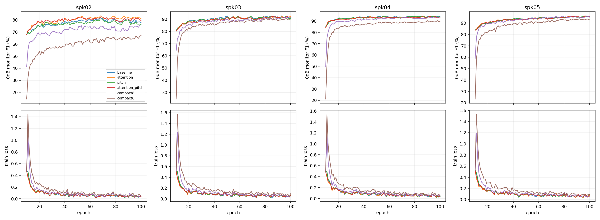

# Attention·발화 구간 피치·경량화 실험

기준은 이전 선택본: 기존 소음 p0.5·SNR[-5,20], 약한 포먼트 p0.5, Dropout0.2, WD1e-4, 보조없음·필터없음.
4fold:02~05 각각 검증, 나머지3화자 학습. test01 음성은 읽거나 평가하지 않는다.
동일 noise epoch10 LAST 모델·AdamW·RNG에서11~100epoch, batch16·609draw/epoch. encoder1e-5/head5e-4 유지, 전체 인코더 학습.
마스킹은 실제 혼합 파형에서 고정 Silero가 산출한 확률만 사용한다. soft key bias log(g), speech-weighted mean, g=.05+.95p; 경계80ms 확장·무검출 시 전체 구간 유지.
피치는 원본 자동VAD 구간 안의 PCHIP 곡선8종/파일, 랜덤 변곡 위치·방향·강도, 최대 변화속도32반음/초. 피치 변형 전후 발화 바깥은 동일하다. 기존 공통 포먼트는 이후 기존 방식 그대로 적용하며, 추가 소음은 항상 마지막에 혼합한다.
원본VAD 구간을 평가에 주는 결과는 source-region 진단이며 배포 성능이나 후보 선택에 쓰지 않는다. 경계는 수동 정답이 아닌 기존 자동 검출 기록이다.
기준12블록과 같은100epoch 예산으로 선택된 조건의8/6블록을 추가 비교한다. 균등한 깊이에서 남길 층을 고정하고 해당 파라미터·AdamW 상태를 보존한다.

| 조건 | 완료fold | 파라미터 | 0dB F1 | 정확도 | 최저화자 F1 | 원본 F1 |
|---|---:|---:|---:|---:|---:|---:|

조건 채택: 기준보다4fold 평균 F1 +0.5%p 이상, 최저 개별 화자 하락1%p 이내. raw 최고점도 별도로 남긴다.
경량화 허용: 선택12블록 대비 평균 F1 하락0.5%p 이내·개별 화자 하락1%p 이내. 통과 모델 중 가장 작은 모델을 표시한다.

[현재 진행](progress.json) · [고정 조건](protocol.json) · [검증 검사](preflight.json) · [진단](diagnostics.csv)

