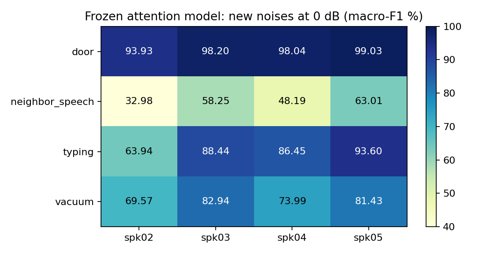

# Attention 최고 모델: 새로운 소음 일반화 확인

관측 최고 attention의 기존 4개 개발 화자 checkpoint를 고정하고, 필터·재학습 없이 평가했다.
16kHz·1.5초, 기존 정의의 0dB, 소음별 3개 추출. test01은 읽거나 평가하지 않았다.

기존 8종 F1 재현: **91.6418%**, 원본 F1 99.7726%.
새 4유형 동일가중 평균 F1: **76.9992%**; 7개 파일 동일가중 평균 77.0016%.

| 새 소음 유형 | 파일 수 | 0dB F1 | 정확도 | 화자02 F1 | 잡음 단독 오반응 |
| --- | ---: | ---: | ---: | ---: | ---: |
| 문 닫힘 | 2 | 97.30% | 97.41% | 93.93% | 3.75% |
| 키보드 타이핑 | 2 | 83.11% | 83.74% | 63.94% | 1.25% |
| 청소기 | 1 | 76.98% | 77.87% | 69.57% | 0.00% |
| 옆 사람 말소리 | 2 | 50.61% | 55.25% | 32.98% | 98.12% |

문 닫힘은 이번 표본에서 강했고, 키보드·청소기는 성능 손실이 컸으며, 방해 말소리가 가장 큰 약점이었다. 말소리 조건은 모든 개발 화자에서 낮았고, 화자02가 특히 취약했다.
방해 말소리만 입력한 160개 조건 중 157개를 명령으로 오인했다. 기존 8소음의 잡음 단독 오반응률 1.5625%와 크게 다르다. VAD는 말소리 여부를 추정하며, 비명령 말소리를 거절하는 전용 모듈은 현재 구성에 없다. 이번 결과만으로 세부 원인을 인과적으로 분리한 것은 아니다.
파일별 변동도 크다. 두 말소리 파일의 F1은 각각 61.82%·39.40%, 두 타이핑 파일은 89.89%·76.32%였다.

기존과 새 소음 집합의 난이도가 달라 두 평균의 차이를 모델 개선·퇴보량으로 해석하지 않는다.
새 소음 평가는 기존 개발 화자에 대한 평가이며, 새로운 화자에 대한 독립 test가 아니다.
타이핑·문 닫힘·말소리는 각 2파일, 청소기는 1파일이다. 번호가 다른 파일이 독립 녹음 세션임을 보장하지 않는다.
이전 분류기 훈련 6개 및 기존 평가 8개의 원본·준비 파일 해시와 겹치지 않음을 확인했다. 원본 ASR 사전학습까지 완전히 미관측이라는 주장은 하지 않는다.
0dB는 원본 전체 파형 파워 대 추가 소음 파워다. silence와 잡음 단독은 fold 훈련 명령어 RMS 중앙값 기준이다.
소음 단독은 파일별·화자별 20개 창이며, 발화가 있는 혼합 F1과 별도로 본다.

[MS-SNSD 공식 소음 출처](https://github.com/microsoft/MS-SNSD/tree/fe61c4ba0d9ac8dd7e23d719cc79f8947e1dc742/noise_test)
[고정 프로토콜](protocol.json) · [원본 출처](noise_sources.json) · [파일별](noise_summary.csv) · [화자별](speaker_family.csv) · [검증](audit.json)

[독립 검산](independent_audit.json): 244개 조건의 confusion matrix에서 F1·정확도를 재계산하고, 새 혼합 17,612개를 저장된 crop·gain으로 독립 재생성해 SHA256 일치를 확인했다. 기존 attention 예측 20,940개가 일치했고, 새 입력 812개는 VAD부터 다시 계산해 예측 일치를 확인했다.

기존 실험 소스와 checkpoint는 보존했다. 이번 학습은 없고 추가 실험도 자동으로 시작하지 않았다. 결과와 새 스크립트는 `attention-pitch-v1` 브랜치에 보존한다.

재실행은 저장된 원본·캐시를 유지한 상태에서 아래 명령을 사용한다. 완료된 평가는 다시 실행하지 않으며 독립 검산은 재실행할 수 있다.

```bash
PYTHONUTF8=1 /root/audio/.worktrees/pretrain/runs/denoise-env/bin/python -u -m experiments.evaluate_attention_unseen_noise
PYTHONUTF8=1 /root/audio/.worktrees/pretrain/runs/denoise-env/bin/python -u -m experiments.check_attention_unseen_noise
```


