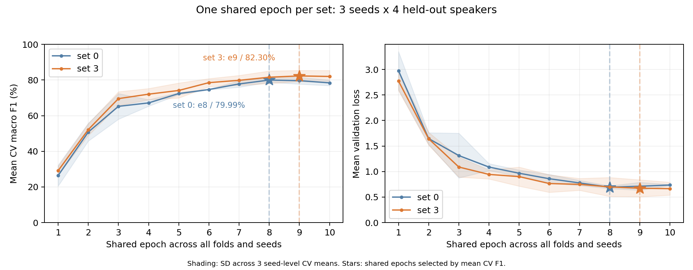

# 총합 기준의 공통 최고 epoch 비교

원래 실험과 같은 mask+speed·weight decay1e-4·Dropout0에서 세트0과3을 비교했다. 세트마다 **3시드(42/43/44)×4-fold(spk02~05) 전체 평균 Macro F1이 최고인 공통 epoch 하나**를 골랐다. 모든 화자·시드에 같은 epoch를 적용하며 화자1은 선택에서 제외했다.

## 전체3시드·4-fold 결과

| 모델 | 공통 최고 epoch | 평균 CV F1 | 시드별 CV F1 표준편차 | 평균 정확도 | 평균 loss |
| --- | ---: | ---: | ---: | ---: | ---: |
| 세트0 | 8 | 79.99% | 1.18%p | 79.72% | 0.6937 |
| 세트3 | 9 | 82.30% | 3.12%p | 81.53% | 0.6731 |

보조 포함 세트3의 평균 F1 차이는 **+2.32%p**다. 앞서 화자별 최고 epoch를 각각 선택한82.51%/84.62%와 집계 방식이 다르다. CV의 각 fold 모델은 학습 화자 구성이 다르며, 여기서는 그4개 모델에 같은 학습 시점을 적용한다.

[전체240행 학습 기록](all_seed_fold_epoch_histories.csv) · [epoch별 총합](all_seed_common_epoch_means.csv) · [선택 epoch의24개 fold/seed 점수](fold_seed_at_selected_epoch.csv)

같은 epoch에서 양쪽을 직접 비교하면 다음과 같다.

| 공통 epoch | 세트0 평균 F1 | 세트3 평균 F1 |
| --- | ---: | ---: |
| 8 | 79.99% | 81.58% |
| 9 | 79.66% | 82.30% |

## 공통 epoch에서 화자별3시드 평균

| 화자 | 세트0 F1 | 세트3 F1 | 차이 |
| --- | ---: | ---: | ---: |
| spk02 | 63.14% | 68.05% | +4.92%p |
| spk03 | 85.75% | 85.87% | +0.12%p |
| spk04 | 83.82% | 86.08% | +2.26%p |
| spk05 | 87.25% | 89.21% | +1.97%p |

## 같은 seed44의 파일별 비교

위에서 고른 공통 epoch8/9을 그대로 썼다. 이 비교는3시드 평균과 구분한다. seed44만으로 공통 최고 epoch를 골라도 같은8/9가 선택된다.

| 화자 | 세트0 F1 | 세트3 F1 | 정답 세트0→3 | 세트3만 정답 / 세트0만 정답 |
| --- | ---: | ---: | ---: | ---: |
| [spk02](spk02.md) | 55.13% | 59.10% | 108→111 | 26 / 23 |
| [spk03](spk03.md) | 87.02% | 86.47% | 175→174 | 14 / 15 |
| [spk04](spk04.md) | 84.02% | 87.42% | 175→180 | 9 / 4 |
| [spk05](spk05.md) | 88.38% | 83.65% | 177→167 | 10 / 20 |
| [spk01](spk01.md) | 67.00% | 62.18% | 135→130 | 11 / 16 |

spk01은spk02-fold 모델(학습03/04/05)의 별도 평가이며 어떤 총합에도 넣지 않았다. 각 화자 문서에는 한쪽만 정답·둘 다 오답인 모든 파일의 양쪽 예측과 WAV 링크가 있다.

seed44의 CV812개에서 세트3만 정답 59개, 세트0만 정답 62개다. 총 정답은 635→632개다.

### 화자별 평균과812개를 합친 지표의 구분

| seed44 지표 | 세트0 | 세트3 |
| --- | ---: | ---: |
| 4-fold 평균 Macro F1 | 78.64% | 79.16% |
| 평균 정확도 | 78.20% | 77.83% |
| 812개 예측을 합친 Macro F1 | 78.92% | 79.00% |
| 평균 loss | 0.7235 | 0.8600 |

화자별 F1을 평균하는 방식과 예측을 합쳐 F1을 계산하는 방식은 다르다. 원래 연구의 주 지표인4-fold 평균 F1로 epoch를 선택했고,812개 합산 F1이나 정확도로 다시 고르지 않았다. seed44에서는 F1이 조금 높아도 정답 수와loss는 보조 포함 쪽이 나빴다.

[812개 전체 짝 비교](seed44_all_812_paired.csv) · [세트3만 정답](seed44_812_set3_only_correct.csv) · [세트0만 정답](seed44_812_set0_only_correct.csv) · [단어별 정답 수](seed44_class_correct_counts.csv)

## 검증 범위

- 원래 학습 기록24개/240행에서 전체 평균과 선택epoch를 재계산했다. 학습 소스19개는 변경하지 않았다.
- 파일별 예측이 없던 spk05의 세트0/3만 각10epoch 별도 재현했다. 원래 history·최적 가중치 텐서·최적 예측·점수가 모두 일치했다. 이번 추가20epoch, 누적 파일 진단80epoch이며 정식184회와 구분한다.
- 공통 최고점의 두 세트×(CV812개+별도spk01 203개)=2,030개 예측에서 정확도/F1/NLL을 재계산했다.
- 공통epoch도 같은 개발 CV로 선택한 사후 분석이다. 독립 일반화 성능이 아니며 화자1은 선택에 사용하지 않았다. 청취 검수는 하지 않았다.

[각자 최고점 비교](../best_checkpoint_comparison/README.md) · [전체 실험](../README.md)
