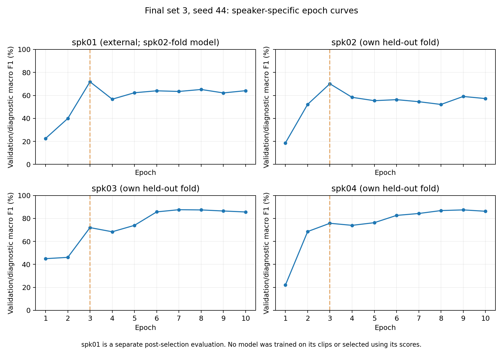

# 최종 세트3: 화자별 악화 파일 조사

범위: seed44, 최종 공통 조건 mask+speed, 세트3. 비교 시점은 모두 epoch3→10이다. spk02/03/04의 재현은 원래 학습 history·최적 모델 텐서·최적 예측과 모두 일치했다.

spk01은 사용자의 별도 조사 요청에 따라 spk02 fold 모델(학습 spk03/04/05)로 평가했다. 기존 184회 CV와 최종 조건 선택은 변경하지 않았다. 이번 spk01 분석을 기존 CV 결과나 새로운 미공개 test 점수로 섞지 않는다.

| 화자 | 평가 방식 | F1 epoch3→10 | 정답 수 /203 | 정답→오답 | 오답→정답 |
| --- | --- | ---: | ---: | ---: | ---: |
| [spk01](spk01.md) | spk02 모델의 별도 외부 평가 | 71.86%→64.12% | 140→133 | 24 | 17 |
| [spk02](spk02.md) | 각자 미학습 화자로 둔 CV | 70.14%→57.26% | 136→110 | 43 | 17 |
| [spk03](spk03.md) | 각자 미학습 화자로 둔 CV | 72.02%→85.61% | 149→172 | 10 | 33 |
| [spk04](spk04.md) | 각자 미학습 화자로 둔 CV | 75.78%→86.23% | 153→177 | 10 | 34 |

spk01/02는 이 비교에서 전체 점수가 내려갔다. spk03/04는 일부 악화 파일이 있어도 회복 파일이 더 많아 전체 점수는 올라갔다. 동일한 후반 악화가 모든 화자에게 나타난 것은 아니다.

## 바로 열 파일 목록

- [spk02 악화 43개 전체·음성 링크](spk02.md)
- [spk01 별도 진단](spk01.md)
- [spk03 진단](spk03.md)
- [spk04 진단](spk04.md)
- [화자별 요약 CSV](speaker_summary.csv)

각 목록에는 정답·후반 예측·실제 WAV 링크·원본 파일명이 있다. 전체 CSV에는 10개 epoch의 예측과 정답 확률, 원본 길이·패딩·gain을 포함한다.

원래 최고 epoch부터 끝까지의 악화도 별도 목록으로 제공한다. spk03은 epoch7→10에 7개, spk04는 epoch9→10에 4개이며, epoch3→10 목록과 기준이 다르다.

## 해석과 검증

- 정답→오답은 모델의 예측 변화다. 그 파일이 불량 녹음이거나 라벨이 틀렸다는 뜻이 아니다. 청취 기반 원인 판정은 하지 않았다.
- 정답 수 감소는 정답→오답에서 오답→정답을 뺀 값과 일치한다. Macro F1은 파일별로 단순 가산되지 않으므로 파일 수만으로 F1 하락을 분해하지 않는다.
- 매 epoch의 CSV에서 정확도·macro F1과 정답 확률의 NLL을 다시 계산해 저장 지표와 비교했다.
- 진단용 재현 30 epochs는 원래 정식 실험 184회에 추가해 조건을 다시 선택한 실험이 아니다.

