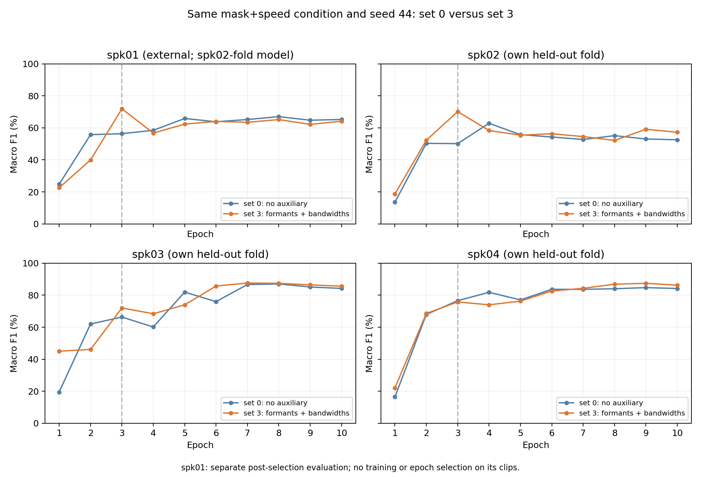

# 보조 특징 제외/포함: 같은 파일·같은 epoch 비교

세트0(보조 없음)과 세트3(포먼트 F1–F3+대역폭 B1–B3)을 동일한 mask+speed·seed44·weight decay 1e-4·Dropout 0·화자 분할로 비교했다. 원래 정식 실행은 변경하지 않았다.

| 화자 | 세트0 F1 epoch3→10 | 세트3 F1 epoch3→10 | 악화 개수 세트0 / 세트3 | 회복 개수 세트0 / 세트3 |
| --- | ---: | ---: | ---: | ---: |
| [spk01](spk01.md) | 56.36%→65.23% | 71.86%→64.12% | 19 / 24 | 37 / 17 |
| [spk02](spk02.md) | 50.13%→52.55% | 70.14%→57.26% | 30 / 43 | 35 / 17 |
| [spk03](spk03.md) | 66.33%→84.22% | 72.02%→85.61% | 6 / 10 | 47 / 33 |
| [spk04](spk04.md) | 76.55%→84.17% | 75.78%→86.23% | 7 / 10 | 28 / 34 |

spk02/03/04는 각자 학습에서 제외한 CV fold다. spk01은 두 세트 모두 spk02 fold 모델(학습 spk03/04/05)에 넣은 별도 평가이며 CV 평균에 넣지 않는다.

## 초반 성능 차이를 반영한 파일 비교

| 화자 | 둘 다 epoch3에 정답 | 그중 세트0 악화 | 그중 세트3 악화 | 둘 다 악화 | epoch10 세트3만 정답 / 세트0만 정답 |
| --- | ---: | ---: | ---: | ---: | ---: |
| spk01 | 102 | 13 (12.7%) | 13 (12.7%) | 9 | 13 / 11 |
| spk02 | 83 | 24 (28.9%) | 23 (27.7%) | 14 | 25 / 19 |
| spk03 | 113 | 5 (4.4%) | 4 (3.5%) | 2 | 13 / 10 |
| spk04 | 134 | 5 (3.7%) | 3 (2.2%) | 3 | 10 / 8 |

앞서 spk02 세트3에서 악화한 43개 중 세트0에서도 악화한 파일은 14개다. 세트0에서 정답 유지 9개, 오답 유지 19개, 회복 1개다. [43개 파일의 양쪽 예측과 WAV 링크](spk02.md).

## 해석

세트3의 spk02 하락 폭만으로 보조를 빼면 더 좋다고 결론내릴 수 없다. 세트0의 epoch3 점수가 50.13%로 더 낮고, epoch10도 52.55%로 세트3 57.26%보다 낮다. spk02의 원래 선택점도 세트0 epoch4 62.82%, 세트3 epoch3 70.14%다. 다만 보조가 각 파일의 오류에 미친 인과는 이 한 시드 비교로 분리할 수 없다.

spk02 loss는 epoch3→10에 세트0 1.7256→1.6870, 세트3 1.1441→1.8016다. epoch10에 세트3의 F1이 더 높아도 평균 정답 NLL은 더 나쁘다. 분류 정답 여부와 예측 확신의 변화는 별도로 보아야 한다.

spk01은 세트3의 큰 초반 우위가 후반에 사라지고 epoch10에는 세트0이 소폭 높다. spk03/04는 두 모델 모두 epoch3보다 epoch10 점수가 높다. 같은 epoch는 같은 학습 진척을 보장하지 않으며, 더 많은 시드의 파일 진단이나 사전에 고정한 정지 정책의 별도 검증 없이 이 사례로 학습 조건을 다시 선택하지 않는다.

## 검증과 산출물

- 세트0 재현3회도 원래 history CSV·최적 가중치 텐서·최적 예측 CSV·지표와 모두 일치했다.
- 두 세트·4화자·10epoch의 16,240개 예측에서 정확도/F1/NLL을 재계산했다. 동일 파일·정답·전처리 metadata도 확인했다.
- 기존 정식184회/1,840epochs는 변경하지 않았다. 후속 파일 진단 재현은 세트3 30epochs+세트0 30epochs다.
- [화자 요약 CSV](speaker_summary.csv). 각 화자 Markdown에 기존 세트3 악화 파일과 세트0 악화 파일 전체를 WAV 링크로 제공한다. 각 화자 CSV는10epoch 예측·정답확률·NLL·원본파일명·패딩을 함께 담는다.
- 사람의 청취나 라벨 재검수는 하지 않았다. 파일명 태그·패딩의 오류 원인도 확정하지 않았다.

