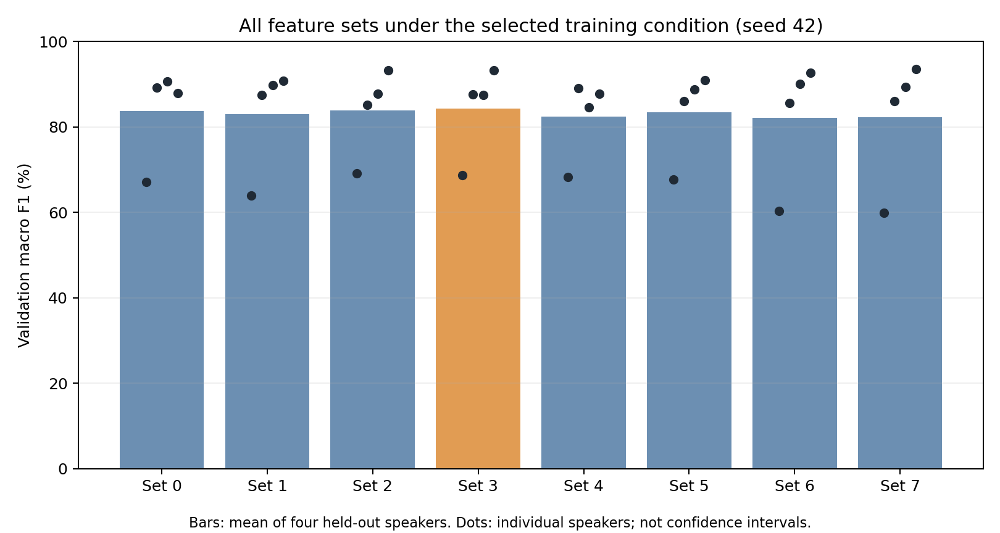
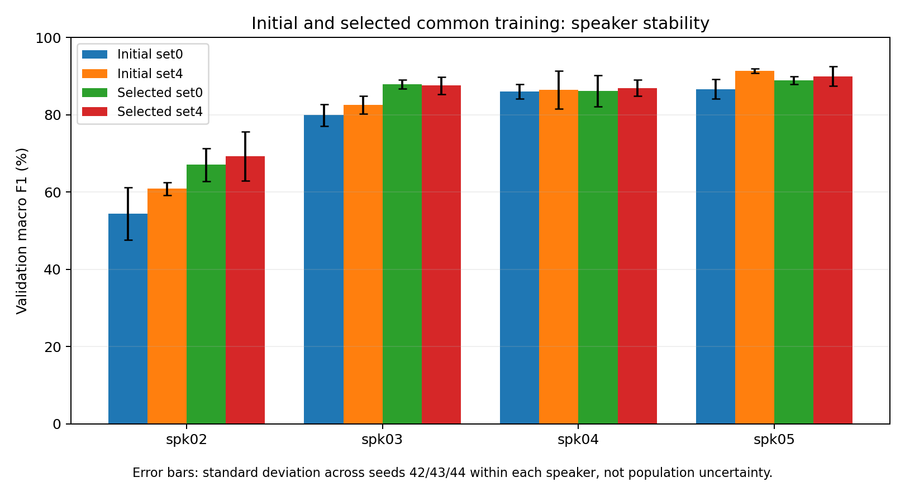

# 결과 해석

사전 절차에 따른 정식 학습 **184회**를 완료했다. 공통 조건의 최종 선택은 **세트 3**다. 주 지표는 개발 화자 4-fold 평균 macro F1이며, 조건과 최적 epoch 선택에 사용한 개발 점수다.

## 지난 실험에서 바뀐 점

이전 16회 실험은 시간 정렬 보조 입력과 동일 초기값 비교, 512차원 표현 보존을 구현했다. 하지만 단일 검증 화자의 3시드 F1이 기준 89.26%, 세트4 89.09%로 일관된 개선이 없었다. 이번에는 원본 주변음을 더 보존한 새 데이터에서 화자별 CV, 개별 증강 선별과 확인, 정규화 비교를 거쳐 동일 학습 조건으로 전체 특징 세트를 다시 비교했다. 데이터와 평가 방식이 달라 이전 89%와 이번 CV 점수의 높낮이를 직접 비교하지 않는다.

같은 새 데이터·CV의 3시드 평균에서 무증강→선택 조건은 세트0 76.76%→82.51%, 세트4 80.32%→83.42%다. 이 변화와 보조 입력의 효과를 구별해 해석한다.

## 학습 조건 선택

모든 선별은 seed42, 유망 조건 확인은 seed42/43/44를 사용했다. 공통 조건 채택 기준은 세트0·4 평균 F1 +0.5%p 이상, 두 모델을 평균한 최저 화자 F1 하락 1%p 이내, 각 세트 평균 하락 0.5%p 이내다. 이는 사전 의사결정 기준이며 통계 검정이 아니다.

| 단계·후보 | 비교 시드 수 | 세트0·4 평균 F1 | 최저 화자 F1 |
| --- | ---: | ---: | ---: |
| 개별 증강: pitch | 1 | 77.71% | 58.20% |
| 개별 증강: speed | 1 | 79.63% | 65.80% |
| 개별 증강: noise | 1 | 78.43% | 58.59% |
| 개별 증강: mask | 1 | 79.70% | 56.47% |
| 정규화: weight decay 0.001, dropout 0 | 1 | 84.02% | 66.45% |
| 정규화: weight decay 0.0001, dropout 0.2 | 1 | 82.95% | 65.47% |
| 앞단·학습률: 앞단 고정 True, 본체 LR 비율 1 | 1 | 78.95% | 56.40% |
| 앞단·학습률: 앞단 고정 False, 본체 LR 비율 0.1 | 1 | 54.81% | 35.38% |

개별 증강은 무증강을, 정규화·앞단·학습률은 그 단계에서 선택한 증강 조건을 기준으로 비교했다. 피치·잡음의 미채택은 이 선별 범위의 결과이며 일반적인 무효 판정이 아니다.

결합 증강 3시드 평균: 82.96%. Weight decay 1e-3은 평균이 높아져도 최저 화자 하락 제한을 넘어 채택하지 않았다.

최종 공통 조건: `{"augmentation": ["mask", "speed"], "backbone_lr_ratio": 1.0, "dropout": 0.0, "freeze_front": false, "weight_decay": 0.0001}`.

## 공통 조건에서 0~7 전체 비교

아래는 모든 세트를 동일하게 비교한 seed42의 4-fold 결과다. 세트마다 유리한 학습 조건을 따로 쓰지 않았다.

| 세트 | 추가 입력 | 평균 F1 | 최저 화자 F1 |
| --- | --- | ---: | ---: |
| 0 | 스펙트로그램 기준 | 83.71% | 67.10% |
| 1 | F0·변화량·유성 정보 | 82.94% | 63.87% |
| 2 | 포먼트 F1~F3 | 83.79% | 69.06% |
| 3 | 포먼트+대역폭 | 84.23% | 68.63% |
| 4 | 포먼트+변화량 | 82.44% | 68.25% |
| 5 | flatness·flux·centroid | 83.37% | 67.66% |
| 6 | RMS | 82.16% | 60.32% |
| 7 | 전체 보조 특징 | 82.22% | 59.92% |

## 유망 세트의 3시드 확인

seed42 상위 두 세트와 세트0·4를 3시드로 확인했다. 최저 화자는 각 화자의 3시드 평균 중 최솟값이며, 표준편차는 시드별 4-fold 평균 F1 세 개의 모집단 표준편차다. 화자 모집단의 신뢰구간은 아니다.

| 세트 | 평균 F1 | 시드 표준편차 | 최저 화자 F1 | 기준 대비 평균 차이 |
| --- | ---: | ---: | ---: | ---: |
| 3 | 84.62% | 1.67%p | 72.34% | +2.11%p |
| 2 | 83.82% | 0.88%p | 69.58% | +1.32%p |
| 4 | 83.42% | 1.53%p | 69.24% | +0.91%p |
| 0 | 82.51% | 1.09%p | 67.06% | +0.00%p |

보조 입력은 기준 대비 평균 F1이 0.5%p 이상 높고 최저 화자 하락이 1%p 이내일 때만 선택한다. 이 기준에 따라 세트 3 선택으로 결정했다. 3시드와 네 화자로 통계적 우월성이나 보편적인 개선을 주장하지 않는다.

## 동일 발화의 정답·오답 변화

공통 학습 조건의 세트0과 최종 선택 세트를 같은 화자·시드·발화끼리 짝지었다. 각 시드는 네 검증 화자의 812개 클립를 한 번씩 포함한다. 세 시드는 같은 발화를 재사용한다.

| 시드 | 기준 오답→선택 정답 | 기준 정답→선택 오답 |
| --- | ---: | ---: |
| 42 | 47 | 46 |
| 43 | 73 | 42 |
| 44 | 69 | 59 |

[개별 짝지은 예측](paired_predictions.csv), [혼동 쌍](error_pairs.csv), [반복 오답](persistent_errors.csv)에 근거를 남겼다. 예측만으로 발음·거리·잡음 중 원인을 확정하지 않는다.

## 속도 변형과 여백 확인

고정 캐시의 단어 변형 1,600개 중 797개는 가속 후 부족한 길이만 0 패딩했고, 784개는 감속 후 기존 검수 구간을 포함하도록 잘랐다. 19개는 보호 구간이 넘쳐 감속을 건너뛰었다. 추가 0 패딩은 최대 약 135.8ms이며 silence 변형 24개는 원본을 유지했다. 이는 학습 중 실제 추출 횟수가 아닌 고정 변형 수다. 기존 검수 구간 보존은 확인했지만 실제 발화 경계의 정답을 새로 검수한 것은 아니다. [증강 적용 감사](augmentation_application_audit.json)에 기록했다.

## 남는 한계와 검증

- 개발 화자는 네 명이며 조건과 epoch를 같은 개발 CV로 선택했다. 독립 최종 평가가 아니다.
- spk01은 이번 학습·특징 추출·모델 평가에서 제외했다. 이전 실험에서 이미 확인한 test이므로 새로운 미공개 test로 주장하지 않는다.
- 짧은 원본 350개에는 부족한 길이만 0을 채웠다. 패딩 비율·녹음 환경·거리의 화자별 차이를 분리 통제하지 못했다.
- 파형 증강은 클립당 고정 변형 2개다. 현재 주 지표는 원본 검증 성능이며 새 잡음·공간·거리의 강건성 향상을 직접 평가하지 않았다.
- F0/포먼트의 availability는 측정 가능 표시이며 정확도의 정답이 아니다. 추출 품질이 추가 입력의 효과에 영향을 줄 수 있다.
- 피크 예외 6개는 원본 검수 구간·수치를 확인했지만 사람의 청취 검수는 하지 않았다.

정식 184회×10 epochs의 예측·점수·최적 epoch·분할·scaler·초기값·소스 해시를 재검증했다. 원본·이전·새 WAV 총 3,045개 해시 보존과 Linear(512,11)을 확인했다. 복구 검증 4 epochs는 선택에 쓰지 않았다. [실행 감사](execution_audit.json), [실행별 감사](run_audit.csv), [고정 프로토콜](protocol.json)에 기록했다.

단계별 학습–검증 격차와 후반 과적합의 실제 근거는 [과적합 분석](overfitting.md)에 정리했다.

후속 사용자 요청으로 [화자별 악화 파일 진단](file_diagnostics/README.md)을 추가했다. spk02·03·04의 seed44 학습을 동일하게 재현해 epoch별 예측을 복원했고, spk01은 선택 완료 후 별도로 평가했다. 이 후속 분석은 기존 184회 CV·최종 조건 선택과 구별한다.
