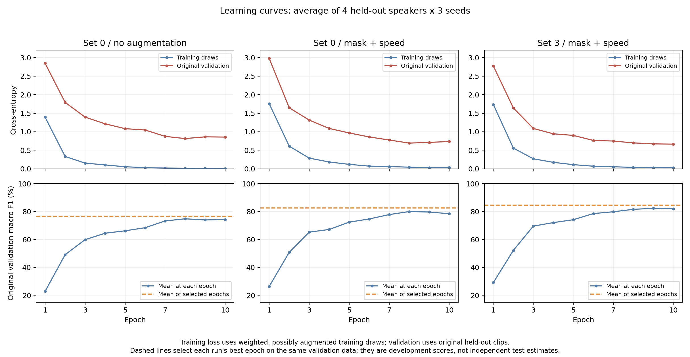
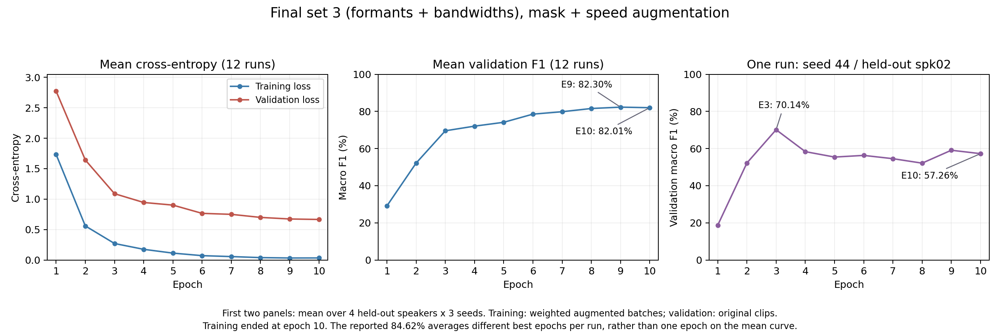

# 단계별 과적합 근거와 해석

이 문서는 완료된 실험 기록을 재집계한 분석이다. 추가 학습이나 test 평가는 하지 않았다.
원자료는 [all_runs.csv](all_runs.csv), 실행별 `runs/*/history.csv`와 `summary.json`이다.
재집계는 [실행별 진단](overfitting_run_diagnostics.csv), [조건별 요약](overfitting_condition_summary.csv)에 저장했다.

## 무엇을 측정했는가

- 학습 F1: 각 실행의 최적 checkpoint를 원본 학습 클립 609개에서 eval 모드로 재평가한 macro F1이다. 증강된 학습 배치의 F1이 아니다.
- 검증 F1: 같은 checkpoint를 학습하지 않은 화자 203개 클립에서 평가한 macro F1이다.
- 격차: 학습 F1 − 검증 F1, 단위는 %p다. 이는 일반화 격차이며 그 전체를 과적합의 양으로 확정할 수 없다. 화자·환경·거리·패딩 분포 차이가 함께 영향을 줄 수 있다.
- 아래 3시드 평균은 seed42/43/44×4화자의 12회 평균이다. seed42 비교는 4회 평균이며, 두 범위의 숫자를 섞어 비교하지 않는다. 세트0을 기준으로 먼저 설명하고 세트4 결과는 따로 표시한다.
- 시간에 따른 과적합 근거는 동일 실행에서 학습 loss가 감소하면서 검증 loss가 증가하거나 검증 F1이 하락하는지다. 학습 loss는 역빈도 샘플링·증강·train 모드의 배치에서, 검증 loss는 원본·eval 모드에서 측정하므로 loss의 절댓값 차이만으로 판정하지 않는다.

## 1. 무증강: 큰 일반화 격차

| 모델, 3시드 | 학습 F1 | 검증 F1 | 격차 |
| --- | ---: | ---: | ---: |
| 세트0 | 99.90% | 76.76% | 23.14%p |
| 세트4 | 99.66% | 80.32% | 19.34%p |

학습 자료는 거의 완벽히 맞추면서 새 화자 성능이 낮다. 이 결과는 학습 자료에 대한 강한 적합과 큰 일반화 문제를 보여준다.
세트0의 화자별 3시드 검증 F1은 spk02 54.42%, spk03 79.90%, spk04 86.05%, spk05 86.66%다.
따라서 평균 차이를 전부 모델 용량 탓으로 설명할 수는 없다.

후반의 실제 곡선에서도 세트0의 12회 평균은 epoch8→10에 학습 loss 0.0151→0.0100,
검증 loss 0.8154→0.8561, 검증 F1 74.80%→74.30%였다.
이는 후반 과적합을 뒷받침하는 패턴이지만, 모든 fold가 같은 시점에 악화된 것은 아니다.

## 2. 증강: 격차는 감소, 후반 안정성이 모두 개선된 것은 아님

| 세트0, 3시드 | 학습 F1 | 검증 F1 | 격차 |
| --- | ---: | ---: | ---: |
| 무증강 | 99.90% | 76.76% | 23.14%p |
| 속도 | 99.80% | 78.99% | 20.81%p |
| 마스킹 | 99.94% | 80.38% | 19.56%p |
| 마스킹+속도 | 99.58% | 82.51% | 17.07%p |

학습 점수를 크게 희생하지 않고 검증 성능이 올라 격차가 줄었다. 조합은 무증강보다 격차를 6.07%p 줄였다.
세트4도 무증강 19.34%p→조합 16.51%p로 격차가 감소했다.

피치·잡음은 seed42에서만 선별했다. 세트0의 피치는 학습 99.92%, 검증 77.46%, 격차 22.46%p,
잡음은 99.70% / 78.02% / 21.67%p다. 같은 seed42 무증강 세트0의 격차는 25.33%p였다.
그러나 세트4 검증은 무증강 79.35%→피치 77.96%, 잡음 78.84%로 내려갔다.
이들은 모델별 효과가 엇갈려 선별 기준을 통과하지 못했으며 3시드 확인도 없다. "과적합을 더 키워 탈락"으로 해석하지 않는다.

증강 조합의 세트0은 epoch8→10 평균 학습 loss 0.0444→0.0334,
검증 loss 0.6937→0.7365, 검증 F1 79.99%→78.42%였다.
새 화자 성능은 좋아졌지만 후반 악화가 사라진 것은 아니다.

## 3. Weight decay·Dropout: 세트마다 효과가 다름

아래는 **모두 seed42, 세트0**이며 마스킹+속도 위에 각 조건만 추가했다.

| 조건 | 학습 F1 | 검증 F1 | 격차 |
| --- | ---: | ---: | ---: |
| 기존: WD 1e-4, Dropout 0 | 99.62% | 83.71% | 15.91%p |
| WD 1e-3 | 99.96% | 82.55% | 17.41%p |
| Dropout 0.2 | 99.51% | 80.65% | 18.86%p |

세트0에서는 두 설정 모두 일반화 격차를 줄이지 못했다. 다만 세트4는 반대다.
WD의 세트4 검증 F1은 82.44%→85.49%, 격차는 17.37%p→14.32%p였고,
Dropout도 검증 85.26%, 격차 14.51%p로 좋아졌다.
따라서 정규화 자체가 무효라는 결론은 아니다.

WD는 두 세트 평균 F1이 83.08%→84.02%로 높아졌지만 두 모델을 평균한 최저 화자는
67.68%→66.45%로 1.23%p 떨어져 사전 제한 1%p를 넘었다. Dropout도 채택 기준을 통과하지 못했다.
둘 다 3시드 확인을 하지 않았으므로 시드에 강건한 효과로 확정하지 않는다.
Dropout은 평가 시 비활성화하는 정상적인 방식으로 학습 F1을 측정했다.

## 4. 앞단 고정·학습률 분리: 이번 10epoch 범위에서 악화

아래도 **seed42, 세트0**이며 같은 마스킹+속도 조건이다.

| 조건 | 학습 F1 | 검증 F1 | 격차 |
| --- | ---: | ---: | ---: |
| 기존 전체 학습 | 99.62% | 83.71% | 15.91%p |
| 앞단 고정 | 99.96% | 76.28% | 23.68%p |
| 본체 LR 0.1배 | 96.42% | 48.61% | 47.81%p |

앞단을 고정해도 남은 모듈이 학습 자료를 거의 완벽히 맞췄고 새 화자는 더 못 맞췄다.
본체 LR 0.1배는 학습 성능도 낮아졌으므로 47.81%p를 단순히 "가장 심한 과적합"으로 순위 매길 수 없다.
오디오 도메인 적응 제한·최적화·학습 시간 부족이 함께 작용했을 수 있다. 원인을 분리하는 비교는 수행하지 않았다.
특히 이 결과는 10epoch에서의 결과이며 학습 시간을 늘린 작은 LR의 우열은 확인하지 않았다.

## 5. 공통 조건의 특징 세트 비교

먼저 모든 세트를 동일하게 비교한 **seed42** 결과다.

| 세트 | 추가 입력 | 학습 F1 | 검증 F1 | 격차 |
| --- | --- | ---: | ---: | ---: |
| 0 | 없음 | 99.62% | 83.71% | 15.91%p |
| 1 | F0·변화량·유성 정보 | 99.96% | 82.94% | 17.02%p |
| 2 | 포먼트 | 99.96% | 83.79% | 16.17%p |
| 3 | 포먼트+대역폭 | 99.28% | 84.23% | 15.05%p |
| 4 | 포먼트+변화량 | 99.81% | 82.44% | 17.37%p |
| 5 | 스펙트럼 보조 특징 | 100.00% | 83.37% | 16.63%p |
| 6 | RMS | 100.00% | 82.16% | 17.84%p |
| 7 | 전체 특징 | 99.85% | 82.22% | 17.62%p |

입력을 많이 추가한다고 격차가 줄지는 않았다. 상위 후보와 기준의 **3시드 확인**은 다음과 같다.

| 세트 | 학습 F1 | 검증 F1 | 격차 |
| --- | ---: | ---: | ---: |
| 0 | 99.58% | 82.51% | 17.07%p |
| 2 | 99.92% | 83.82% | 16.10%p |
| 3 | 99.41% | 84.62% | 14.78%p |
| 4 | 99.92% | 83.42% | 16.51%p |

세트3은 세트0보다 검증 F1 +2.11%p, 격차 −2.29%p였고,
최저 화자 3시드 평균도 67.06%→72.34%로 좋아졌다.
시드별 세트3−세트0 CV 차이는 +0.51 / +4.10 / +1.73%p다.
세 시드에서 방향은 같지만 차이의 크기는 달라 네 화자·세 시드만으로 보편적인 효과를 보장하지 않는다.

## 최종 모델에 남는 후반 과적합과 선택 편향

세트3 전체 12회 평균 검증 loss는 epoch9→10에도 0.6731→0.6653으로 낮아졌다.
F1은 82.30%→82.01%로 조금 낮아졌다. 따라서 최종 모델 전체가 동시에 후반 과적합에 빠졌다고 단정하지 않는다.

하지만 일부 실행에는 강한 악화가 있다. `세트3 / seed44 / spk02`는 epoch3→10에:

- 학습 loss: **0.2788→0.0245**
- 검증 loss: **1.1441→1.8016**
- 검증 F1: **70.14%→57.26%**

학습 자료에는 더 잘 맞는데 새 화자 성능은 나빠지는 직접적인 사례다.
[해당 학습 기록](runs/c2ed04a871308_set3_seed44_spk02/history.csv)에 근거가 있다.

| 3시드 조건 | fold별 최적 epoch 평균 F1 | 모두 epoch10일 때 F1 | 차이 |
| --- | ---: | ---: | ---: |
| 무증강 세트0 | 76.76% | 74.30% | 2.46%p |
| 마스킹+속도 세트0 | 82.51% | 78.42% | 4.09%p |
| 마스킹+속도 세트3 | 84.62% | 82.01% | 2.61%p |

이 차이는 실행별로 다른 최적 epoch를 선택한 효과까지 포함한다. 최댓값은 마지막 값 이상이므로
표의 차이만으로 모든 실행에서 후반 과적합이 입증되는 것은 아니다.
84.62%는 같은 검증 자료로 조건·epoch를 선택한 개발 점수이며 독립 최종 평가 점수가 아니다.
최적 epoch를 썼다고 과적합이 제거됐다는 뜻도 아니다.

## Epoch10의 의미와 최종 세트 곡선

10은 이번 실험에서 미리 정한 학습 종료 epoch이며 과적합 시작점으로 측정한 값이 아니다.
10epoch 이후의 기록은 없다. 최종 세트3의 12회 평균 검증 F1은 epoch9 82.30%→epoch10 82.01%로
0.29%p 낮아졌지만, 검증 loss는 같은 구간 0.6731→0.6653으로 개선됐다.
한 번의 F1 하락만으로 전체 모델의 과적합 시작점을 epoch10이라고 판정할 수 없다.
개별 실행은 다르며 앞서 든 seed44/spk02의 최고 검증 F1은 epoch3이었다.

[최종 세트 epoch별 평균 수치](final_set3_epoch_summary.csv) · [SVG 원본](final_set3_learning_curves.svg)

후속 사용자 요청으로 [화자별 악화 파일 진단](file_diagnostics/README.md)을 추가했다. spk02·03·04의 seed44 학습을 동일하게 재현해 epoch별 예측을 복원했고, spk01은 선택 완료 후 별도로 평가했다. 이 후속 분석은 기존 184회 CV·최종 조건 선택과 구별한다.
