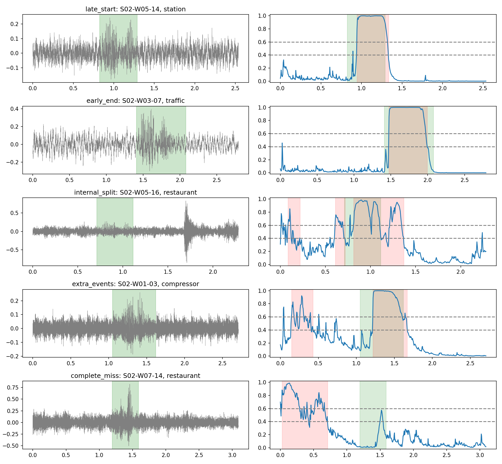

# 검출기 오답 유형과 기존 CNN 분류기 비교

**주된 문제는 발화 완전 누락보다 약한 시작 경계 잘림과 배경 구간 추가 검출이다. 0dB 소음을 약하게 하면 개선되지만 원본의 끝 경계 오류도 남아, 소음만으로 설명되지는 않는다.**

검출기 TCN60 / CNN-GRU109, 기존 분류기 mean300 / pooled640 / self354 최고 체크포인트를 고정해 재추론했다. 재학습·임계값 변경·테스트 화자 접근은 없다. 노정민 검증200원본 × 8소음 × 0/5/10dB와 원본 조건이다. 서로 다른 소음crop 반복이 아닌 각 조건별 고정crop을 사용했다.

분류기에는 **검출기와 같은 혼합 파형**에서 정답 발화 중앙에 맞춘1.5초 창을 제공했다. 창 밖 원본 부족분만0으로 채웠고 추가 음량정규화는 없다. 포먼트/BW 보조 특징은 그 noisy 창에서 다시 추출했다. 따라서 분류기는 정답 위치를 제공받는 유리한 조건이며, F1과 정확도를 같은 과제 점수로 비교할 수 없다. 과거 고정1.5초 자료의 저장 예측과 새 원본 ID를 임의로1:1 대응시키지 않았다.

0dB/original 검출기 재현3,600건 중3,599건은 저장 예측과 일치했고, GRU1건은 시작10ms 차이가 있었다. 배치 길이가 바뀐 재추론에서의 차이이며 건별audit에 기록했다. 보고한 주요 F1은 저장 결과와 같다.

## 1. 증강은 완전히 같지 않았다

| 항목 | 기존 acoustic CNN 분류기 | 이번 검출기 |
|---|---|---|
| 소음 원본 | 학습6개/검증8개 | 같은 파일, SHA256 집합 일치 |
| 학습 SNR | uniform -5~20dB | 동일 범위 |
| 소음 세기 기준 | 1.5초 전체 원음 평균전력/전체 소음 전력 | 주석 발화 영역 원음 전력/같은 영역 소음 전력 |
| 소음 적용 | noisy 분류 view100%, 원본 reference view 별도 | 양성 window80%, 추가noise-only window |
| 포먼트 | 확률50%, 1/1.1~1.1, 고정2변형 | 없음 |
| 별도 음량 gain | 없음(공통 peak attenuation 제외) | -6~+3dB, clipping 제한 |
| 입력 | 고정1.5초 clip | 전체 original에 먼저 혼합 후1.5초 window |
| 손실 | CE + same-command SupCon0.1 | 경계 가중 frame BCE |
| 모델 | 약8.5만params, 양방향CNN문맥+선택적pooling, 음향보조라인 | TCN22,465 / GRU18,209, causal temporal layers, 보조라인없음 |

새 원본의 정답 중앙1.5초 창에서 발화부와 전체 평균전력 차이는 중앙값 **4.70dB**다. 같은 원음/안정적소음이라고 가정하면 전체전력0dB 방식은 발화부 기준으로 약+4.7dB인 셈이다. 이는 현재 파일에서 계산한 정의 차이의 크기이며 과거 모든 실제 혼합의 발화부SNR을 측정한 값은 아니다. 비정상 소음의 부분별전력 및 기존배경 때문에 실제 차이는 달라진다.

## 2. 0dB 오류 유형

1600혼합 입력 전체 기준. 시작/끝 잘림은20ms 초과이며 유형은 중복 가능하다. 발화와 겹치는 예측이 전혀 없는 경우를 완전 누락으로 따로 집계했다. 추가검출은 정답과 전혀 겹치지 않는 별도 구간이다.

| 유형 | TCN | CNN-GRU |
|---|---:|---:|
| 완전 누락 | 9/1600 (0.6%) | 27/1600 (1.7%) |
| 시작20ms 이상 늦음 | 1068/1600 (66.8%) | 1170/1600 (73.1%) |
| 끝20ms 이상 빠름 | 342/1600 (21.4%) | 412/1600 (25.8%) |
| 발화 내부 분할 | 98/1600 (6.1%) | 50/1600 (3.1%) |
| 발화 밖 배경 구간 추가 | 666/1600 (41.6%) | 404/1600 (25.2%) |
| 배경 총50ms 이상 포함 | 1027/1600 (64.2%) | 822/1600 (51.4%) |

이전에 말한 GRU425개의 다중구간 출력 중 실제 내부분할은50개, 배경 추가는404개다(29개중복). TCN은707개 중 내부98/배경666개(57개중복). 따라서 다중출력 전체를 발화가 쪼개졌다고 해석하면 잘못이다.

## 3. 소음 종류별 양상과 분류기

GRU의 event F1은 IoU>=0.5 매칭과 추가 이벤트 수를 함께 반영한다. CNN 수치는 같은 혼합의 정답 중앙 창에서의 명령어 정확도다. 각 소음200건이다.

| 소음 | GRU 검출F1 | Mean 명령어정확도 | Pooled | Self | GRU 배경추가 |
|---|---:|---:|---:|---:|---:|
| cafeteria | 49.1% | 70.0% | 73.0% | 66.5% | 123/200 |
| car | 98.8% | 98.5% | 98.5% | 99.0% | 1/200 |
| compressor | 40.2% | 71.5% | 76.5% | 70.0% | 91/200 |
| fan | 83.5% | 94.0% | 92.5% | 87.0% | 17/200 |
| restaurant | 44.9% | 57.5% | 58.0% | 56.5% | 156/200 |
| station | 85.9% | 88.5% | 84.5% | 78.5% | 7/200 |
| traffic | 92.9% | 94.5% | 91.5% | 88.5% | 4/200 |
| washing | 97.1% | 98.0% | 98.0% | 96.5% | 5/200 |

식당·카페테리아는 분류기도 어렵고 검출기의 배경추가가 특히 많다. 실제 배경발화 여부는 청취검증하지 않았으므로 원인으로 단정하지 않는다. 압축기는 GRU가TCN보다도 낮아, 단순히 사람소음만 문제인 것이 아니다. 차량·세탁기는 발화 검출이 높지만 경계 잘림은 남는다.

## 4. 단어별 차이

각 명령어160건. 검출률은 추가이벤트 벌점이 없는 정답event recall, 검출F1과 다르다.

| 명령어 | GRU 검출률 | 시작20ms 잘림 | 끝20ms 잘림 | Mean 정확도 | Pooled | Self |
|---|---:|---:|---:|---:|---:|---:|
| 출발 | 76.9% | 53.8% | 18.1% | 90.0% | 91.2% | 73.8% |
| 정지 | 94.4% | 75.6% | 63.1% | 76.2% | 82.5% | 63.1% |
| 전진 | 98.1% | 75.6% | 51.2% | 81.9% | 79.4% | 79.4% |
| 후진 | 75.6% | 82.5% | 13.1% | 77.5% | 81.9% | 77.5% |
| 왼쪽 | 85.6% | 84.4% | 6.9% | 85.6% | 78.1% | 59.4% |
| 오른쪽 | 79.4% | 60.0% | 21.2% | 84.4% | 68.8% | 76.9% |
| 시작 | 56.9% | 81.2% | 22.5% | 79.4% | 90.6% | 96.2% |
| 복귀 | 86.9% | 68.1% | 26.9% | 89.4% | 93.1% | 98.1% |
| 대기 | 79.4% | 74.4% | 12.5% | 80.6% | 88.8% | 86.2% |
| 재시작 | 86.2% | 75.6% | 21.9% | 95.6% | 86.2% | 92.5% |

전진·정지는 검출률98.1/94.4%인데 끝20ms 이상잘림51.2/63.1%다. 단어의 주요부분을 잡았어도 끝을 보존하는 별도문제가 있다. 반대로 시작은 검출률56.9%인데Self분류96.2%라, 단어를 구별하는 능력과 정확한시작위치를 찾는 능력이 다르다. 이런 차이를 특정음소나 받침 때문이라고 단정하려면 정렬·청취가 필요하다.

Mean의 주요0dB오분류는 시작→재시작24건, 정지→대기19건, 왼쪽→오른쪽14건, 전진→정지14건, 후진→대기14건이다. Pooled는 전진→정지26건, Self는 왼쪽→오른쪽47건이 가장많다. 검출기는 단어간혼동 대신 경계·배경구분에서 실패한다.

GRU가IoU0.5검출을 실패한289건 중 Mean분류기는185건을 맞혔다. 반대로 GRU검출성공1311건 중 Mean오답은151건이다. 같은 입력에서도 실패가 동일하지 않다.

## 5. 소음세기 대조

모델·임계값·noise crop·정답을 고정하고 추가소음 세기만 변경했다. 원본도 반드시무잡음이라는 뜻은 아니다.

| 조건 | GRU 검출F1 | GRU 시작20ms 잘림 | Mean 정확도 | Pooled | Self |
|---|---:|---:|---:|---:|---:|
| 원본 | 95.9% | 10.5% | 98.5% | 99.0% | 97.0% |
| 10dB | 82.7% | 58.2% | 97.4% | 95.4% | 92.4% |
| 5dB | 78.5% | 68.4% | 94.7% | 91.8% | 88.5% |
| 0dB | 70.7% | 73.1% | 84.1% | 84.1% | 80.3% |

0dB라도 표시된 시작50ms의 원음대추가소음비는 중앙값 **-13.7dB**, 끝50ms는 **-20.4dB**다. 발화전체평균0dB가 약한경계까지0dB라는 뜻은 아니다. 이 값은 표시경계구간의원음전력이지 순수음성전력이 아니며, 정답에미세여유가있다면그영향도포함한다.

시작50ms SNR이 -10dB이하인1014건에서 시작잘림75.8%, +5dB초과31건에서는29.0%다. 소음과경계손실의관련성을뒷받침하지만 서로다른단어·소음이섞인관찰상관이다. 같은crop에서소음만바꾼0/5/10dB대조가소음세기의영향에대한더직접적인근거다.

## 6. 해석과 다음 검토

발화유무만 판단하는 문제는 명령어10종구분보다 단순할 수 있다. 그러나 지금은 모든시간프레임의 라벨과 약한시작·끝을찾고, 다른배경구간을거부해야한다. 분류기는 강한중간부분만으로도맞힐수있고 이번대조에서는 정답위치도제공받았다. 라벨종류가2개라는이유만으로정밀자르기가더쉬워지지는않는다.

소음이큰원인이라는추측은실측으로지지된다. 다만원본에서도GRU끝20ms잘림25%, 정밀단일구간±30ms성공49.5%라소음만약하게하면모두해결되는상황은아니다. 현재비대칭frameBCE가약한경계와최종자르기목표를충분히학습시키는지, 라벨에미세여유가있는지, 미래문맥부재가영향주는지는추가검증대상이다.

다음은 (1) 제시한파형·확률사례를라벨과함께청취확인, (2) 시작·끝보존/배경추가를따로평가, (3) 발화부SNR정의를통일한기준선, (4) 같은모델의대칭/비대칭손실대조 순서가적절하다. 현재결과로1000에포크연장이나용량부족을결론내리지않는다.

그래프의 초록은정답구간, 빨강은예측구간, 파랑은speech확률이다. 대표사례는유형별실패조건의중간cost에서골랐으며 랜덤독립표본은아니다.

재현: `PYTHONUTF8=1 CUBLAS_WORKSPACE_CONFIG=:4096:8 /root/CAS2250-resnet18-pretrain-100/.venv/bin/python -m experiments.analyze_boundary_errors`

전체cases CSV, SNR/noise/command집계, classifier혼동, 경계SNR분포, audit.json을같은폴더에저장했다. CSV snr_db=99는원본조건표기이며실제99dB를뜻하지않는다.
