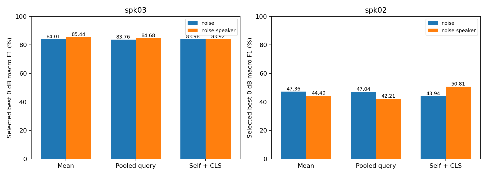
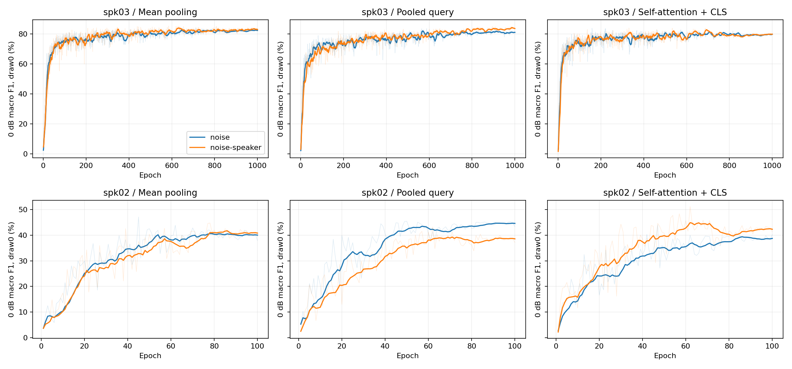

# Compact CNN 소음·화자 대조학습 결과 정리

**화자03에서는 평균 풀링+화자 대조가 최고, 화자02에서는 self-attention+화자 대조가 최고였다. 화자 대조 효과와 구조 순위는 화자별로 달랐다.**

완료: 한국시간 2026-11-15 21:28:11~22:03:15, 실제 경과 35.06분. 3모델×2조건×(1000+100) = **6,600 model-epochs**. 두 조건을 같은 RTX3090에서 병렬 실행했다.

## 어떤 실험인가

| 항목 | 설정 |
|---|---|
| 모델 | 공통 작은 CNN 뒤 Mean pooling / 대표쿼리 Pooled attention / 작은 Self-attention+CLS |
| 추론 파라미터 | Mean77,835 / Pooled78,859 / Self86,315 |
| 초기화 | 모두 무작위. 사전학습 없음. 같은 CNN·분류기 초기값, 이후 독립 학습 |
| 검증 | spk03은1000epoch, spk02는100epoch. 각 분할은 나머지 개발화자3명609개 학습 / 검증203개 |
| 입력·증강 | 전체1.5초,64-bin logmel. 약한 포먼트p0.5, 원본/추가소음2뷰, SNR U[-5,20]dB |
| 소음만 대조 | 같은 녹음의 원본·소음 버전만positive. 다른 녹음의 같은 명령어는negative로 쓰지 않고 제외 |
| 화자까지 대조 | 같은 명령어의 다른 녹음·학습화자도positive. 두 조건 모두 silence는CE만 적용 |
| 손실 | CE +0.1 SupCon, temperature0.1,32→64→32 학습 전용 투영부는 추론 시 제거 |
| 최고 epoch 선택 | 고정0dB draw0의8소음별 macro F1 평균 최고, 동률은먼저 나온epoch |
| 최종점수 | 선택checkpoint의 원본 / 8소음×3crop 0dB 평균. 종료점도같은조건 평가 |

검출기/VAD 없이 전체 음성을 사용했다. 학습/평가 소음원본은 분리했고, 두 대조조건의 모든 학습 파형 변형·소음 crop·SNR trace 파일1,100쌍이 정확히 일치한다. 동일 명령어를 다른 화자가 발음한 경우까지 가깝게 만드는 것이며, 화자 ID를 입력 특징으로 주거나 검증 화자를 학습한 것이 아니다.

## 1. 최고checkpoint 비교 — 0dB macro F1

아래 최고checkpoint는 선택용 draw0 최고에서의 최종3draw 점수다. 매epoch 최종3draw를 평가해 골랐다는 뜻이 아니다. 원본 F1 최고를 별도로 골라 합치지도 않았다.

### spk03, 최대1000epoch

| 모델 | 소음만 | 소음+화자 | 화자추가 차이 | 선택epoch 소음만 / 화자포함 |
|---|---:|---:|---:|---|
| Mean pooling | 84.01% | 85.44% | +1.43%p | 712 / 585 |
| Pooled query | 83.76% | 84.68% | +0.92%p | 588 / 895 |
| Self-attention + CLS | 83.98% | 83.92% | -0.06%p | 159 / 331 |

### spk02, 최대100epoch

| 모델 | 소음만 | 소음+화자 | 화자추가 차이 | 선택epoch 소음만 / 화자포함 |
|---|---:|---:|---:|---|
| Mean pooling | 47.36% | 44.40% | -2.96%p | 45 / 78 |
| Pooled query | 47.04% | 42.21% | -4.83%p | 50 / 62 |
| Self-attention + CLS | 43.94% | 50.81% | +6.87%p | 47 / 62 |

화자03: Mean은 화자 포함85.44%로 관측 최고이며 원본95.89%, 잡음단독 오반응4.38%다. 화자02: Self+CLS는 화자 포함50.81%로 관측 최고지만 잡음단독 오반응35.42%가 남았다. 고점만으로 실제 운용 구성을 확정하지 않는다.

## 2. 최고점의 원본·잡음·오반응과 종료점

| 화자 | 모델 | 조건 | 최고점 원본 F1 | 최고점0dB F1 | 종료점0dB F1 | 최고점 잡음단독 오반응 |
|---|---|---|---:|---:|---:|---:|
| spk03 | Mean pooling | noise | 94.03% | 84.01% | 82.44% | 6.04% |
| spk03 | Pooled query | noise | 94.91% | 83.76% | 81.48% | 10.21% |
| spk03 | Self-attention + CLS | noise | 95.91% | 83.98% | 80.90% | 8.75% |
| spk02 | Mean pooling | noise | 69.96% | 47.36% | 38.56% | 15.42% |
| spk02 | Pooled query | noise | 67.88% | 47.04% | 44.74% | 36.04% |
| spk02 | Self-attention + CLS | noise | 62.35% | 43.94% | 40.46% | 35.00% |
| spk03 | Mean pooling | noise-speaker | 95.89% | 85.44% | 83.40% | 4.38% |
| spk03 | Pooled query | noise-speaker | 92.64% | 84.68% | 83.74% | 10.42% |
| spk03 | Self-attention + CLS | noise-speaker | 94.58% | 83.92% | 79.95% | 16.46% |
| spk02 | Mean pooling | noise-speaker | 70.54% | 44.40% | 39.01% | 24.38% |
| spk02 | Pooled query | noise-speaker | 61.69% | 42.21% | 37.52% | 33.12% |
| spk02 | Self-attention + CLS | noise-speaker | 72.30% | 50.81% | 41.83% | 35.42% |

모든 실행에서 종료점0dB F1은 선택checkpoint의 최종0dB F1보다 낮았다. 학습을 길게 했다고 마지막 가중치가 최선은 아니다. 이 표만으로 모든 후반 악화를 과적합으로 확정하지 않는다. epoch별 학습·검증 loss와 F1은 원본 history에 보존했다.

## 3. 1000epoch를 진행한 화자03의 변화

아래는 **같은 cosine1000 학습 경로**의 epoch100과1000을 고정 draw0로 비교했다. cosine100으로 별도로 학습한 모델과의 비교가 아니다. 앞 표의 최종3draw와 집계가 다르다.

| 모델 | 조건 | epoch100 0dB F1 | epoch1000 0dB F1 | 변화 |
|---|---|---:|---:|---:|
| Mean pooling | noise | 74.11% | 82.30% | +8.18%p |
| Pooled query | noise | 71.33% | 81.10% | +9.78%p |
| Self-attention + CLS | noise | 73.91% | 80.28% | +6.37%p |
| Mean pooling | noise-speaker | 74.94% | 82.98% | +8.05%p |
| Pooled query | noise-speaker | 74.67% | 83.49% | +8.82%p |
| Self-attention + CLS | noise-speaker | 80.10% | 80.30% | +0.20%p |

Mean/Pooled은 이 경로에서100epoch 이후에도 개선됐다. Self+CLS 화자대조는80.10→80.30%로 종료점 차이가 작았고, 최고 epoch는331이었다.

곡선의 얇은 선은 원본epoch 기록, 굵은 선은 가독성을 위한10epoch 이동평균이다. 점수 선택에는 이동평균을 사용하지 않았다.

## 4. 추론 속도 — 현재 서버 실측

batch1,1.5초 음성,CPU2threads,20회워밍업 후100회. 화자03/화자포함 조건의 선택checkpoint를 사용했다. 모든 대조학습 projection은 제거했다.

| 모델 | GPU 모델만 중앙값 | CPU파형→GPU frontend·모델→CPU예측 중앙값 | CPU frontend+모델 중앙값 |
|---|---:|---:|---:|
| Mean pooling | 1.00ms | 1.31ms | 2.83ms |
| Pooled query | 1.13ms | 1.44ms | 2.90ms |
| Self-attention + CLS | 1.55ms | 1.86ms | 3.55ms |

WAV읽기·모델로딩·1.5초음성을모으는시간·발화종료판단·통신은 제외했다. 실제 서비스 응답지연 전체가 이 수치라는 뜻은 아니다. GPU타이밍은 동기화했고 p95는 inference_latency.json에 있다.

## 5. 해석과 남은 비교

- 화자 대조가 모든 모델·화자에서 개선된 것은 아니다. spk03 Mean/Pooled은 개선됐고, spk02 Mean/Pooled은 악화·Self만 개선됐다. 한 seed에서의 관측이다.
- spk02와03은 검증화자와 학습화자 구성·학습예산이 모두 다르다. 두 결과를 같은 예산의4-fold CV 평균으로 합치지 않는다. spk02의 낮은 성능 원인을 모델 용량이나 발음 중 하나로 확정하지 않는다.
- 이 서버에서 진행한 것은 대조학습2조건이다. 동일 입력/학습량의paired-CE 대조군을100/1000epoch로 실행하지 않았다. 따라서 여기서 대조학습 자체가 CE보다 얼마나 좋아졌는지는 확정하지 않는다.
- 다른 서버의기본CE는100epoch·소음p0.5이고 여기서는두뷰·추가소음p1.0이다. torch/CUDA버전도달라 원격CE와의차이를 순수로스효과로 주장하지 않는다.
- 최고 epoch를고른draw0가최종3draw에포함돼있다. 개발화자2명·seed42의선별결과이며 독립test01은읽지않았다. 새소음유형·방해말소리·실서비스거절성능은미측정이다.

## 재현·감사

6,600개 epoch 기록과 선택 체크포인트 12개의 저장 예측을 확인했다. 원본·혼합 예측에서 F1을 독립 재집계했고, 증강 기록 1,100쌍이 같음을 검증했다. 학습 소스 해시도 프로토콜과 일치한다.

[화자·모델별CSV](comparison.csv) · [전체epoch기록](epoch_histories.csv.gz) · [학습예산진단](epoch_budget_diagnostics.csv) · [전체감사](summary_audit.json) · [추론시간](inference_latency.json) · [기존예측검증](result_checks.json)

실행별 protocol.json·summary.json·선택 예측·최종 지표는 reports/compact-{noise,noise-speaker}-{spk03-e1000,spk02-e100}/ 아래에 보존했다. 체크포인트와 증강 기록은 대응하는 runs/에 보관한다. 이번 정리에서는 추가 학습 없이 기존 기록 재집계와 추론 시간 측정만 수행했다.

[분류 로스만 쓴 다른 브랜치와 비교](CE_BRANCH_COMPARISON.md)
