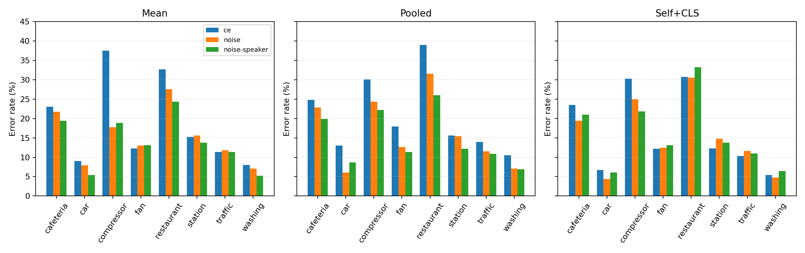
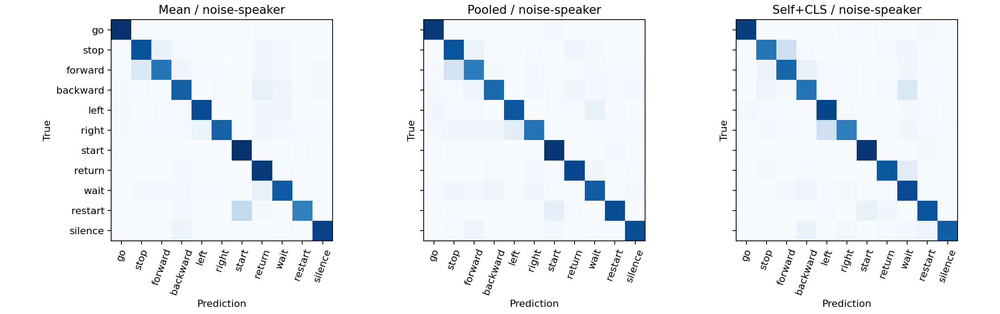

# 화자03: 세 모델의 오답 파일·명령어·소음 분석

**Mean / Pooled / Self+CLS 각각의 CE·소음대조·화자포함대조, 총9조합을 모두 같은 파일·소음 조건으로 비교했다.** CE는 새1000epoch 릴리스의 예측이며 모든 모델의 선택checkpoint 결과다.

원본은203개다. 소음 평가는 같은203개에8소음×3crop을 반복한4,872조건이며, 서로 다른발화4,872개라는 뜻은 아니다. 표의오답수는조건별건수, F1은소음별·crop별macro F1의평균이다.

## 전체9조합

| 모델 | 학습조건 | 원본오답 /203 | 0dB오답 /4872 | 0dB F1 | 잡음단독 오반응 |
|---|---|---:|---:|---:|---:|
| Mean | ce | 15 | 908 | 79.65% | 20.62% |
| Mean | noise | 13 | 745 | 84.01% | 6.04% |
| Mean | noise-speaker | 9 | 679 | 85.44% | 4.38% |
| Pooled | ce | 13 | 1003 | 78.76% | 23.54% |
| Pooled | noise | 11 | 800 | 83.76% | 10.21% |
| Pooled | noise-speaker | 16 | 718 | 84.68% | 10.42% |
| Self+CLS | ce | 13 | 800 | 82.89% | 20.42% |
| Self+CLS | noise | 9 | 749 | 83.98% | 8.75% |
| Self+CLS | noise-speaker | 12 | 770 | 83.92% | 16.46% |

## 모델별 주요 혼동

| 모델 | 조건 | 자주 틀린 정답→예측, 건수 |
|---|---|---|
| Mean | ce | 재시작→시작 111, 전진→정지 90, 오른쪽→왼쪽 60, 후진→대기 32 |
| Mean | noise | 재시작→시작 158, 전진→정지 87, 후진→복귀 35, 오른쪽→왼쪽 35 |
| Mean | noise-speaker | 재시작→시작 127, 전진→정지 67, 대기→복귀 41, 후진→복귀 38 |
| Pooled | ce | 재시작→시작 131, 전진→정지 118, 정지→전진 66, 오른쪽→왼쪽 63 |
| Pooled | noise | 전진→정지 107, 후진→대기 93, 재시작→시작 64, 전진→대기 59 |
| Pooled | noise-speaker | 전진→정지 87, 오른쪽→왼쪽 46, 재시작→시작 43, 왼쪽→대기 37 |
| Self+CLS | ce | 전진→정지 114, 재시작→시작 99, 대기→후진 52, 오른쪽→왼쪽 41 |
| Self+CLS | noise | 재시작→시작 131, 전진→정지 76, 정지→전진 50, 오른쪽→왼쪽 35 |
| Self+CLS | noise-speaker | 오른쪽→왼쪽 103, 정지→전진 98, 후진→대기 71, 복귀→대기 53 |

- **Mean:** 전체 소음 오답은908→745→679로 줄었다. 다만 재시작→시작은111→158→127로 CE보다 여전히 많다. 화자 포함에서는 재시작·전진이 주요 취약점이다.
- **Pooled:** 전체 소음 오답1003→800→718과 재시작→시작131→64→43이 모두 개선됐다. 전진→정지118→107→87은 남았고, 화자 포함의 원본 오답은13→16으로 늘었다.
- **Self+CLS:** 소음만 대조는749오답으로 화자 포함770보다 적다. 화자 포함은 재시작→시작131→38을 줄였지만, 오른쪽→왼쪽35→103과 정지→전진50→98이 늘었다. 명령어별 개선과 악화가 함께 관찰됐다.

## 어느 소음에서 틀렸나

화자포함 조건의오답: Mean은restaurant148/609,cafeteria118/609,compressor115/609. Pooled는restaurant158/609,compressor135/609,cafeteria121/609. Self는restaurant202/609,compressor133/609,cafeteria128/609다.

식당·구내식당·압축기 녹음에서세모델모두어려웠다. 이평가는소음유형마다원본녹음하나이므로해당유형전체에대한성능으로일반화하지않는다.

## 자주 틀리는 구체적인 파일

각파일은24가지소음조건에서평가했다. 아래는화자포함조건의모델별상위5개다. 전체9조합은 file_robustness.csv에있다.

| 모델 | 파일 | 정답 | 원본예측 | 소음오답 /24 | 오답예측 분포 |
|---|---|---|---|---:|---|
| Mean | audio/재시작/spk03_106.wav | 재시작 | 후진 | 23 | {"복귀": 11, "후진": 9, "대기": 1, "시작": 1, "출발": 1} |
| Mean | audio/재시작/spk03_116.wav | 재시작 | 재시작 | 23 | {"시작": 23} |
| Mean | audio/전진/spk03_142.wav | 전진 | 정지 | 23 | {"정지": 11, "복귀": 7, "후진": 3, "silence": 2} |
| Mean | audio/후진/spk03_187.wav | 후진 | 출발 | 23 | {"대기": 10, "출발": 6, "silence": 5, "복귀": 2} |
| Mean | audio/대기/spk03_020.wav | 대기 | 복귀 | 22 | {"복귀": 12, "정지": 6, "오른쪽": 2, "후진": 1, "전진": 1} |
| Pooled | audio/전진/spk03_132.wav | 전진 | 정지 | 24 | {"정지": 23, "대기": 1} |
| Pooled | audio/후진/spk03_188.wav | 후진 | 복귀 | 24 | {"복귀": 10, "출발": 4, "오른쪽": 4, "silence": 2, "재시작": 2, "전진": 1, "정지": 1} |
| Pooled | audio/오른쪽/spk03_082.wav | 오른쪽 | 후진 | 23 | {"후진": 11, "정지": 8, "출발": 1, "전진": 1, "재시작": 1, "대기": 1} |
| Pooled | audio/전진/spk03_143.wav | 전진 | 정지 | 23 | {"오른쪽": 9, "정지": 9, "silence": 2, "재시작": 1, "후진": 1, "출발": 1} |
| Pooled | audio/전진/spk03_142.wav | 전진 | 정지 | 22 | {"정지": 14, "복귀": 4, "대기": 2, "오른쪽": 1, "후진": 1} |
| Self+CLS | audio/오른쪽/spk03_076.wav | 오른쪽 | 왼쪽 | 24 | {"왼쪽": 24} |
| Self+CLS | audio/재시작/spk03_106.wav | 재시작 | 복귀 | 23 | {"복귀": 18, "왼쪽": 2, "후진": 1, "전진": 1, "대기": 1} |
| Self+CLS | audio/정지/spk03_160.wav | 정지 | 전진 | 23 | {"전진": 23} |
| Self+CLS | audio/후진/spk03_188.wav | 후진 | 대기 | 21 | {"대기": 15, "silence": 3, "전진": 1, "출발": 1, "재시작": 1} |
| Self+CLS | audio/오른쪽/spk03_081.wav | 오른쪽 | 왼쪽 | 20 | {"왼쪽": 19, "후진": 1} |

## 원본부터 틀린 파일

대표 최고점인Mean+화자포함은원본9개를틀렸다. 다른모델을포함한모든원본오답은 original_wrong_predictions.csv에있다.

| 파일 | 정답 | 예측 |
|---|---|---|
| audio/대기/spk03_003.wav | 대기 | 복귀 |
| audio/대기/spk03_016.wav | 대기 | 복귀 |
| audio/대기/spk03_020.wav | 대기 | 복귀 |
| audio/재시작/spk03_106.wav | 재시작 | 후진 |
| audio/전진/spk03_135.wav | 전진 | 정지 |
| audio/전진/spk03_142.wav | 전진 | 정지 |
| audio/정지/spk03_160.wav | 정지 | 전진 |
| audio/후진/spk03_187.wav | 후진 | 출발 |
| audio/후진/spk03_189.wav | 후진 | 오른쪽 |

9조합모두원본부터틀리는공통파일은0개다. 특정파일의녹음·라벨이잘못됐다는결론은예측만으로낼수없다.

## 같은 파일에서 개선과 악화

| 모델 | 전→후 | 원본 수정 / 새오답 | 소음 수정 / 새오답 |
|---|---|---|---|
| Mean | ce→noise | 8 / 6 | 423 / 260 |
| Mean | ce→noise-speaker | 11 / 5 | 460 / 231 |
| Mean | noise→noise-speaker | 8 / 4 | 257 / 191 |
| Pooled | ce→noise | 10 / 8 | 564 / 361 |
| Pooled | ce→noise-speaker | 8 / 11 | 536 / 251 |
| Pooled | noise→noise-speaker | 7 / 12 | 373 / 291 |
| Self+CLS | ce→noise | 10 / 6 | 352 / 301 |
| Self+CLS | ce→noise-speaker | 8 / 7 | 421 / 391 |
| Self+CLS | noise→noise-speaker | 5 / 8 | 318 / 339 |

예를들어Mean의CE→화자포함은소음조건460개를고쳤고, 맞던231개를새로틀려순229개정답이늘었다. 전체점수향상과개별명령어악화가동시에발생한다.

## 원인에 대해 말할 수 있는 범위

- 재시작/시작은문자열상접두부분이달라, 약한초반음절의단서를놓치는지확인할가설이있다. 그러나현재예측만으로재음절이실제로잡음에가려졌거나클리핑됐다고확정하지않는다.
- 전진/정지, 오른쪽/왼쪽의혼동은중요하지만, attention이실제로어느구간에집중했는지·확신도가얼마였는지는저장예측CSV에없다. 주의지도나소음제거기능을이표에서추론하지않는다.
- 원본오답과소음에서만생긴오답을분리했다. 소음조건반복과단일화자·seed1개의한계를유지한다. 전후비교는동일파일조건이며, CE와대조학습은입력노출량·LR스케줄·torch환경이다르므로로스하나의인과효과는아니다.

## 자료

[9조합 요약](summary.csv) · [모든 혼동쌍](confusions.csv) · [명령어별 오류](class_errors.csv) · [소음별 오류](noise_errors.csv) · [파일별24조건 오류](file_robustness.csv)
[모든 오답](all_wrong_predictions.csv.gz) · [원본 오답](original_wrong_predictions.csv) · [원본9조합 예측](original_all_nine_predictions.csv) · [수정/새오답 집계](paired_changes.csv) · [바뀐 개별 예측](paired_changed_predictions.csv.gz)
[CE 예측 출처·해시](ce_reference/provenance.json) · [분석 검사](analysis_audit.json)

추가학습·새test평가는하지않고, 저장된선택checkpoint예측을재분석했다. 음성을청취완료했다고주장하지않는다.

[세 모델 오답 심층 분석](deep/README.md)

[모델 구조·attention 교차 진단](mechanisms/README.md)
