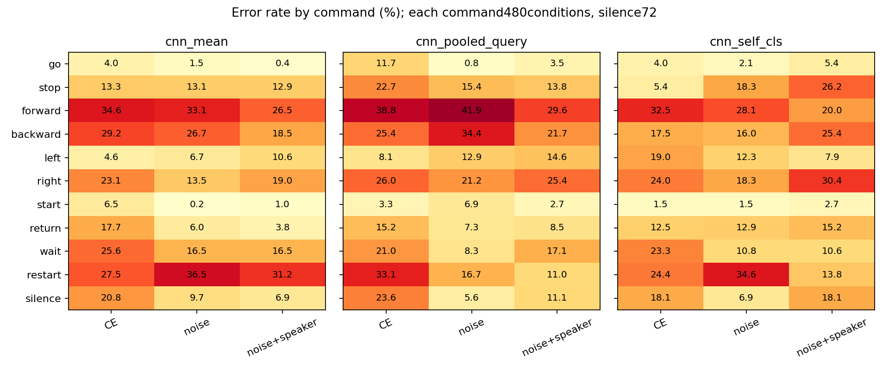
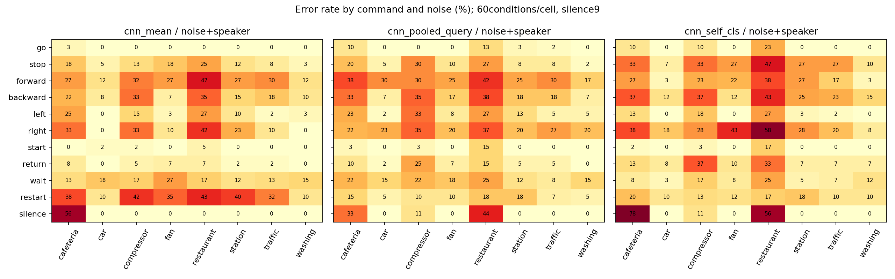

# 화자03 오답 심층 분석: 세 모델 × 세 학습 조건

**평균 풀링은 가장 안정적이지만 재시작을 시작으로 보내는 약점이 남았다. Pooled는 재시작 구별이 개선된 대신 일부 원본과 전진·후진을 놓쳤다. Self+CLS는 화자 대조 후 재시작은 좋아졌지만 좌우·정지 구별이 악화됐다.**

대상은 원본203개와 8소음×3crop=4,872개 혼합 조건이다. 같은 원본을24회 반복한 것이며 독립 발화4,872개가 아니다. 각 모델의 선택checkpoint를 사용했다.

주 비교는 **세 모델 모두 화자 대조 조건**으로 고정했다. 그다음 같은 구조에서 CE→소음 대조→화자 대조가 어떤 명령어를 고치거나 악화시켰는지 비교한다. Self의 개인 최고 조건은 소음만 대조이므로, 이 구분 없이 섞으면 구조 차이와 로스 차이를 혼동한다.

## 1. 전체 점수만으로 보이지 않는 차이

| 모델 | 학습 조건 | 원본 오답 /203 | 소음 오답 /4872 | 0dB macro F1 |
|---|---|---:|---:|---:|
| 평균 풀링 | ce | 15 | 908 | 79.65% |
| 평균 풀링 | noise | 13 | 745 | 84.01% |
| 평균 풀링 | noise-speaker | 9 | 679 | 85.44% |
| Pooled attention | ce | 13 | 1003 | 78.76% |
| Pooled attention | noise | 11 | 800 | 83.76% |
| Pooled attention | noise-speaker | 16 | 718 | 84.68% |
| Self-attention + CLS | ce | 13 | 800 | 82.89% |
| Self-attention + CLS | noise | 9 | 749 | 83.98% |
| Self-attention + CLS | noise-speaker | 12 | 770 | 83.92% |

## 2. 소음이 새로 만든 오답인가, 원본부터 틀린 파일인가

| 모델, 화자 대조 | 원본 정답→소음 오답 | 원본 오답→소음 오답 | 소음 오답 중 새 오답 비중 | 24조건 모두 정답인 원본 | 24조건 모두 오답인 원본 |
|---|---:|---:|---:|---:|---:|
| 평균 풀링 | 516 | 163 | 76.0% | 101/203 | 0/203 |
| Pooled attention | 467 | 251 | 65.0% | 79/203 | 2/203 |
| Self-attention + CLS | 576 | 194 | 74.8% | 76/203 | 1/203 |

평균 모델의679오답 중516건은 원본에서는 맞았던 발화다. 원본 문제만 해결하면 끝나는 상황은 아니다. 반면 Pooled는 원본에서 틀린 파일이 소음에서도 틀린251건으로 비중이 더 크다. 소음이 추가되면서 원본 오답이 맞는 경우도 있어, 개별 잡음이 항상 성능을 악화시킨다고 단정하지 않는다.

## 3. 명령어별 정답률: 무엇을 놓치는가

화자 대조 조건의 recall이다. 각 명령어480조건, silence72조건이며 위의 소음별 평균macro F1과 다른 지표다.

| 실제 명령어 | 평균 풀링 | Pooled | Self+CLS |
|---|---:|---:|---:|
| 출발 | 99.58% | 96.46% | 94.58% |
| 정지 | 87.08% | 86.25% | 73.75% |
| 전진 | 73.54% | 70.42% | 80.00% |
| 후진 | 81.46% | 78.33% | 74.58% |
| 왼쪽 | 89.38% | 85.42% | 92.08% |
| 오른쪽 | 81.04% | 74.58% | 69.58% |
| 시작 | 98.96% | 97.29% | 97.29% |
| 복귀 | 96.25% | 91.46% | 84.79% |
| 대기 | 83.54% | 82.92% | 89.38% |
| 재시작 | 68.75% | 88.96% | 86.25% |
| silence | 93.06% | 88.89% | 81.94% |

## 4. 평균 풀링: 가장 넓게 안정적이나 짧은 구별 단서가 약한 가설

- 화자 대조에서203개 중101개는 모든 소음24조건을 맞혔다. Pooled79개, Self76개보다 많다. 모든24조건을 틀린 원본은0개였다.
- 재시작 recall68.75%가 가장 낮다. 재시작→시작127건인데 역방향은3건이다. 두 단어를 대칭으로 헷갈리는 것보다 재시작을 시작 쪽으로 흡수하는 방향성이 강하다.
- 시작 recall98.96%지만 precision78.51%, 복귀 recall96.25%지만 precision74.76%다. 시작/복귀를 잘 맞히는 것과 다른 단어를 시작/복귀로 잘못 보내는 것이 동시에 나타난다. 실제복귀480조건에 복귀예측618회, 실제시작480조건에 시작예측605회였다.
- 전진→정지67건, 정지→전진32건이다. 오른쪽→왼쪽31건, 왼쪽→오른쪽0건으로 방향도 비대칭이다.
- 화자 대조를 추가하면 후진 오류128→89(-39), 전진159→127(-32), 재시작175→150(-25)가 줄었다. 반면 오른쪽65→91(+26), 왼쪽32→51(+19)은 늘었다. 총오답66건 감소는 모든 명령어의 균일한 개선이 아니다.
- 가장 나쁜 명령어·소음 조합은 식당 소음의 전진28/60오답, 재시작26/60오답, 압축기 소음의 재시작25/60오답이다. 재시작 문제는 한 소음에만 국한되지 않는다.

재시작/시작은 재 음절의 단서를 유지하는지 확인할 좋은 사례다. 그러나 지금 분석만으로 해당 음절이 실제 잘렸거나 평균 풀링이 그 음절을 지웠다고 증명한 것은 아니다.

## 5. Pooled attention: 재시작을 잘 분리하지만 원본 일반화가 악화

- CE→소음→화자 대조에서 재시작→시작131→64→43건으로 개선됐다. 화자 대조의 재시작 recall88.96%는 세 모델 중 가장 높다.
- 반면 전진 recall70.42%, 오른쪽74.58%, 후진78.33%가 약하다. 전진→정지87건과 정지→전진31건이 있고, 정지예측548회로 실제480조건보다 많다.
- 화자 대조는 후진 오류165→104(-61), 전진201→142(-59), 재시작80→53(-27)을 줄였다. 대기는40→82(+42), 오른쪽102→122(+20), 왼쪽62→70(+8)로 악화됐다.
- 소음만 대비 화자 대조의 원본 오답은11→16으로 늘었다. 원본에서7개를 고쳤지만 맞던12개를 새로 틀렸다. 단순한 잡음 제거 개선으로 설명하기 어려운 변화다.
- 24소음조건 전체를 틀리는 원본2개는 전진/spk03_132와 후진/spk03_188이다. 둘 다 원본에서도 각각 정지/복귀로 틀렸다.
- 식당에서 전진25/60, 후진23/60, 오른쪽22/60을 틀렸다. 구내식당에서도 전진23/60, 후진20/60으로 같은 명령어들이 약했다.

평균 쿼리가 특정 소음에 오염됐다는 설명은 가능한 가설이지만 아직 직접 검증하지 않았다. 이 결과로 확인되는 것은 최종 결정의 명령어별 이동과 원본 회귀다.

## 6. Self-attention+CLS: 화자 대조 후 오류가 다른 명령어로 이동

- 소음만 대조의749오답이 화자 포함에서770오답으로 늘었다. 같은 파일 조건에서318건을 고쳤지만339건을 새로 틀렸다.
- 가장 큰 개선은 재시작 오류166→66(-100), 전진135→96(-39), 왼쪽59→38(-21)이다. 재시작→시작도131→38로 크게 줄었다.
- 대신 오른쪽88→146(+58), 후진77→122(+45), 정지88→126(+38)이 늘었다. 오른쪽→왼쪽35→103, 정지→전진50→98이 대표적인 새 오류다.
- 화자 대조에서 전진→정지28건, 정지→전진98건이다. 평균/Pooled와 달리 전진 쪽으로 보내는 방향이 우세하다. 오른쪽→왼쪽103건, 역방향2건으로 좌우의 비대칭도 크다.
- 오른쪽 recall69.58%, 정지73.75%, 후진74.58%가 낮다. 반대로 대기예측615회, 대기 precision69.76%로 다른 명령어가 대기로 잘못 들어간다.
- 식당 소음에서 오른쪽35/60오답(58.33%), 정지28/60, 후진26/60이다. 오른쪽은 fan 소음에서도26/60을 틀려 식당 배경 말소리만의 문제는 아니다.
- 잡음 단독 오반응도 소음만8.75%→화자 포함16.46%로 높아졌다. 이 모델에서는 화자 대조가 명령어 분류와 잡음 거절 모두 일관되게 좋아지지 않았다.

## 7. 같은 음성을 모델별로 어떻게 다르게 틀렸나

화자 대조 조건. 아래 숫자는24소음조건 중 정답 수다. 괄호는 원본 입력의 예측이다.

| 파일 | 평균 풀링 | Pooled | Self+CLS |
|---|---|---|---|
| audio/재시작/spk03_116.wav | 1/24 (재시작) | 6/24 (재시작) | 7/24 (시작) |
| audio/전진/spk03_143.wav | 4/24 (전진) | 1/24 (정지) | 5/24 (전진) |
| audio/오른쪽/spk03_076.wav | 23/24 (오른쪽) | 8/24 (왼쪽) | 0/24 (왼쪽) |
| audio/전진/spk03_132.wav | 6/24 (전진) | 0/24 (정지) | 20/24 (전진) |
| audio/후진/spk03_188.wav | 8/24 (후진) | 0/24 (복귀) | 3/24 (대기) |
| audio/대기/spk03_003.wav | 10/24 (복귀) | 7/24 (대기) | 9/24 (대기) |

오른쪽076은 평균이23/24를 맞히는데 Self는0/24다. 전진132는 Self가20/24를 맞히는데 Pooled는0/24다. 특정파일이 모든 모델에서 본질적으로 인식 불가능한 것은 아니며, 모델별로 다른 단서를 학습했을 가능성이 있다. 음원·정답의 실제 품질은 별도로 청취 검수해야 한다.

## 8. 세 모델이 공통으로 못 맞힌 것과 서로 보완하는 것

4,872조건 중 모두정답3593건, 한모델만오답645건, 두모델오답380건, 모두오답254건이다.

| 공통으로 어려운 파일 | 세 모델 모두 틀린 소음조건 /24 |
|---|---:|
| audio/전진/spk03_143.wav | 18 |
| audio/전진/spk03_142.wav | 16 |
| audio/재시작/spk03_116.wav | 16 |
| audio/후진/spk03_188.wav | 15 |
| audio/후진/spk03_187.wav | 12 |
| audio/정지/spk03_155.wav | 11 |
| audio/오른쪽/spk03_082.wav | 10 |
| audio/전진/spk03_137.wav | 9 |

평균 모델이 틀린679조건 중302개는 Pooled가,313개는 Self가 맞혔다. 반대로 평균은 맞히고 Pooled는 틀린341개, 평균은 맞히고 Self는 틀린404개도 있다. 우열이 완전히 포함관계는 아니다. 이 보완성은 정답을 알고 난 뒤의 분석이며, 실제로 정답 모델을 고르는 방법이 생겼다는 뜻은 아니다.

## 9. 구조에 대해 해석할 때의 주의점

- 공통 CNN의 이론적 시간 수용영역은109개 특징프레임, 약1.105초다. 평균 풀링도 이미 긴 시간 패턴을 학습한 CNN 특징을 평균하므로 시간 정보를 전혀 못 보는 모델이 아니다.
- 세 모델은 같은 초기 CNN에서 시작했지만 학습 후 CNN 가중치는 서로 다르다. 최종 차이를 풀링 연산 하나의 직접 효과로 단정할 수 없다.
- 여기서 화자 포함은 다른 녹음의 같은 명령어를 positive로 추가한 조건이다. 다른 화자뿐 아니라 같은 화자의 다른 녹음도 포함하므로 순수 화자 변수 하나만 분리한 실험이 아니다.
- 저장된 클래스 예측만 분석했다. 확신도, 음소 정렬, attention 지도, 실제 잘린 음절은 이 자료에서 확인하지 않았다. 접두음절 손실·표현 압축·화자 군집화는 후속 검증 가설이다.
- CE와 대조학습은 총1000epoch라도 스케줄·두뷰 노출량·환경이 다르다. 대조조건 두 개는 같은 입력·스케줄에서 positive 구성이 다르지만 선택epoch도 서로 다르다.
- 관찰된 약점에 맞춰 같은 검증 화자를 반복 튜닝하면 개발셋에 적응하게 된다. 이 결과는 원인 가설을 세우는 데 쓰고, 개선은 다른 보류 화자·소음에서도 확인해야 한다.

## 10. 우선 확인할 순서

1. 전진143/142, 후진188/187, 재시작116처럼 공통 오답이 많은 파일은 원본 발화·클리핑·라벨을 청취 검수한다. 틀렸다는 이유만으로 제거하지 않는다.
2. 오른쪽076, 전진132처럼 모델별 차이가 큰 파일은 같은 파형에서 logits·attention/가림 실험을 비교해 사용 단서를 확인한다. 모든 모델을 똑같이 강하게 증강하는 처방보다 원인을 먼저 구분한다.
3. 화자 대조를 유지한다면 전체 F1과 함께 재시작/시작, 전진/정지, 좌우별 recall·precision을 추적한다. 군집을 더 강하게 모으는 것만으로는 다른 명령어 경계의 악화를 막지 못할 수 있다.

[명령어별 precision/recall](precision_recall_bias.csv) · [원본→소음 전이](clean_to_noisy_transitions.csv) · [파일별 오류 집중](file_error_concentration.csv) · [명령어×소음](noise_command_cells.csv)
[화자 대조의 명령어별 변화](speaker_addition_class_changes.csv) · [파일별 변화](speaker_addition_file_changes.csv) · [모델 간 보완성](model_complementarity.csv) · [공통 어려운 파일](common_hard_files.csv)
[모든 조건의 공통오답](per_condition_shared_errors.csv.gz) · [파일별 세부 예측](all_file_cases.csv) · [감사](audit.json) · [전체9조합 원자료](../README.md)

이번 분석에서는 추가 학습과 새 test 평가를 하지 않았다. 자동으로 청취 완료나 음성학적 원인 확정을 주장하지 않는다.

[모델 구조·attention 교차 진단](../mechanisms/README.md)
