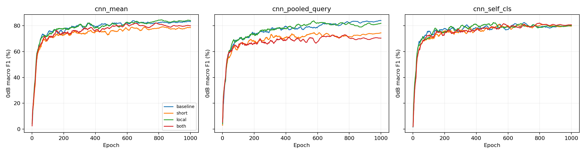

# CNN 시간범위·중간 특징 전달 비교 완료

화자03 검증, 다른 개발화자3명 학습. 소음+화자 대조, seed42,각1000epoch cosine. 기준baseline은 기존 완료 실행을 재사용했고 새3조건만 학습했다.

| 조건 | 모델 | 파라미터 | 최고epoch | 원본F1 | 0dB F1 | 종료점0dB F1 | 잡음단독 오반응 |
|---|---|---:|---:|---:|---:|---:|---:|
| baseline | cnn_mean | 77,835 | 585 | 95.89% | 85.44% | 83.40% | 4.38% |
| baseline | cnn_pooled_query | 78,859 | 895 | 92.64% | 84.68% | 83.74% | 10.42% |
| baseline | cnn_self_cls | 86,315 | 331 | 94.58% | 83.92% | 79.95% | 16.46% |
| short | cnn_mean | 76,555 | 579 | 93.83% | 82.99% | 79.30% | 10.21% |
| short | cnn_pooled_query | 77,579 | 436 | 92.65% | 77.92% | 73.07% | 15.42% |
| short | cnn_self_cls | 85,035 | 538 | 95.03% | 82.74% | 79.19% | 9.38% |
| local | cnn_mean | 79,915 | 806 | 91.97% | 85.44% | 84.44% | 4.58% |
| local | cnn_pooled_query | 80,939 | 565 | 95.42% | 86.77% | 82.76% | 11.88% |
| local | cnn_self_cls | 88,395 | 508 | 96.30% | 85.55% | 80.55% | 12.08% |
| both | cnn_mean | 78,635 | 590 | 93.89% | 84.93% | 80.19% | 15.21% |
| both | cnn_pooled_query | 79,659 | 408 | 87.05% | 76.23% | 70.78% | 24.17% |
| both | cnn_self_cls | 87,115 | 573 | 94.49% | 83.49% | 80.55% | 8.96% |

short=최종 시간범위1.105→0.625초. local=약0.245초 중간 특징을64→32 zero-init residual로 최종특징에 더함. both=둘다. 모든경로에서32차원 readout입력을 유지했다. 파라미터가약1~3%변하므로 완전히동일한용량의실험은아니다.

모든조건의원본·평가소음·학습순서·포먼트·소음/crop/SNR을맞췄다. 선택checkpoint는0dB draw0 최고, 최종표는8소음×3draw평균이다. 같은개발검증에서선택했고 최종평가에도draw0가포함된다. 독립test결과로해석하지않는다.

원본예측에서최종F1을재계산했고 새3조건의3000epoch 증강trace가기준과같음을확인했다. 전체조건/모델별명령어혼동은 comparison.csv에저장했다.

[비교표](comparison.csv) · [전체epoch](epoch_histories.csv.gz) · [감사](completion_audit.json) · [사전검사](preflight.json) · [고정설정](launch_protocol.json)

## 사용자 채택 결정

**중간 특징 전달만(local)을 채택한다.** 기존 넓은 CNN 범위를 유지한다. short/both는 채택하지 않고 재현용으로 보존한다. Mean/Pooled/Self 세 head는 유지하며 CPU latency는 모델 선택 기준에서 제외한다. LR/batch 튜닝은 미실시다.

[병합할 서버에 전달할 내용](MERGE_HANDOFF.md) · [구조/실행법](../../experiments/local_features/README.md) · [상세 검토](REVIEW.md)
