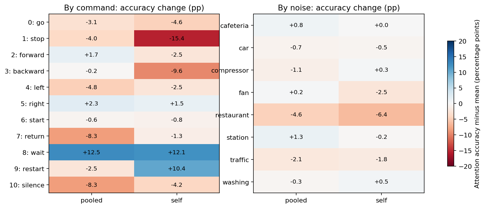

# 중간 특징 전달 모델: 어텐션 추가의 정답/오답 변화

화자03, local 구조, 소음+화자 SupCon, seed42. Mean806/Pooled565/Self508epoch의 소음 검증 최고 체크포인트를 비교했다. 각 입력의 예측을1:1로 짝지었다.

주의: 같은 CNN 구조·초기값에서 시작했지만 각 모델의 CNN도 독립 학습됐고 checkpoint epoch도 다르다. 아래는 완성 모델 간 차이이며 어텐션만 교체한 인과효과가 아니다. Self는 위치인코딩·CLS·FFN도 추가한다. 입력 길이1.5초, 추가잡음0dB만 분석했으므로 다른SNR/음성길이 일반화는 알 수 없다.

## 정답률과 교체 수

| 모델 | 조건 | 평균 오답 | 어텐션 오답 | 기존 오답 수정 | 새 오답 | 평균 정답률 | 어텐션 정답률 |
|---|---|---:|---:|---:|---:|---:|---:|
| cnn_pooled_query | mixed_0db | 611 | 651 | 243 | 283 | 87.46% | 86.64% |
| cnn_pooled_query | original | 15 | 10 | 12 | 7 | 92.61% | 95.07% |
| cnn_self_cls | mixed_0db | 611 | 675 | 295 | 359 | 87.46% | 86.15% |
| cnn_self_cls | original | 15 | 8 | 12 | 5 | 92.61% | 96.06% |

정답률(accuracy)과 기존 보고서의 클래스별 macro F1은 서로 다른 지표다. 소음4872조건은203녹음×8소음×3draw이며 독립4872녹음이 아니다.

## 명령어별 소음 정답률 변화

| 명령어 | Mean 정답률 | Pooled 변화 | Self 변화 |
|---|---:|---:|---:|
| 출발 | 98.75% | -3.12%p | -4.58%p |
| 정지 | 92.71% | -3.96%p | -15.42%p |
| 전진 | 76.25% | +1.67%p | -2.50%p |
| 후진 | 78.54% | -0.21%p | -9.58%p |
| 왼쪽 | 93.12% | -4.79%p | -2.50%p |
| 오른쪽 | 84.58% | +2.29%p | +1.46%p |
| 시작 | 99.17% | -0.62%p | -0.83%p |
| 복귀 | 93.12% | -8.33%p | -1.25%p |
| 대기 | 80.62% | +12.50%p | +12.08%p |
| 재시작 | 76.04% | -2.50%p | +10.42%p |
| silence | 98.61% | -8.33%p | -4.17%p |

## 소음별 정답률 변화

| 소음 | Pooled 변화 | Self 변화 |
|---|---:|---:|
| cafeteria | +0.82%p | +0.00%p |
| car | -0.66%p | -0.49%p |
| compressor | -1.15%p | +0.33%p |
| fan | +0.16%p | -2.46%p |
| restaurant | -4.60%p | -6.40%p |
| station | +1.31%p | -0.16%p |
| traffic | -2.13%p | -1.81%p |
| washing | -0.33%p | +0.49%p |

## 반복적으로 개선/악화되는 녹음

| 모델 | 구분 | 파일 | Mean 정답/24 | Attention 정답/24 |
|---|---|---|---:|---:|
| cnn_pooled_query | 개선 | audio/대기/spk03_020.wav | 3 | 19 |
| cnn_pooled_query | 개선 | audio/전진/spk03_133.wav | 8 | 20 |
| cnn_pooled_query | 개선 | audio/대기/spk03_016.wav | 9 | 20 |
| cnn_pooled_query | 악화 | audio/복귀/spk03_040.wav | 22 | 7 |
| cnn_pooled_query | 악화 | audio/복귀/spk03_042.wav | 21 | 6 |
| cnn_pooled_query | 악화 | audio/정지/spk03_160.wav | 23 | 9 |
| cnn_self_cls | 개선 | audio/전진/spk03_135.wav | 0 | 18 |
| cnn_self_cls | 개선 | audio/재시작/spk03_107.wav | 8 | 21 |
| cnn_self_cls | 개선 | audio/대기/spk03_016.wav | 9 | 21 |
| cnn_self_cls | 악화 | audio/전진/spk03_134.wav | 24 | 0 |
| cnn_self_cls | 악화 | audio/후진/spk03_195.wav | 21 | 0 |
| cnn_self_cls | 악화 | audio/전진/spk03_141.wav | 23 | 7 |

## 해석 범위

어텐션은 시간별 비중을 학습할 수 있지만 항상 유효 발화에 집중한다는 보장은 없다. 짧은 구별 구간을 선택하는 이득과 소음/다른 발음 단서에 비중을 주는 손실이라는 설명은 가능한 가설이며, 해당 구간 청취·정렬로 증명한 결과는 아니다. CNN 특징은 이미 넓은 문맥을 담아 최종 평균도 시간 정보를 간접 활용한다.

잡음만 입력했을 때 오반응은Mean4.58%,Pooled11.88%,Self12.08%였다. 아래 혼합음성 정답률과 별도 조건이며, 어텐션이 잡음을 자동으로 더 잘 무시한다고 해석하면 안 된다.

확인 실험이 필요하면 같은 학습된 CNN을 고정하고 head만 학습하는 비교로 범위를 좁힐 수 있다. 현재는 추가 학습하지 않았다. 동일 개발검증의 결과이며test는 아니다.

파일: summary.csv, class_changes.csv, noise_changes.csv, file_changes.csv, confusions.csv, original_changed_cases.csv, all_paired_predictions.csv.gz. 그림의 명령어는 표와 같은 순서의 영어 label이다.

## 정답률과 macro F1: silence 구분의 영향

0dB 정답률은Mean87.46%,Pooled86.64%,Self86.15%이나 macro F1은85.44%,86.77%,85.55%다. 정답률은 총정답 비율이고 macro F1은 클래스별 precision/recall을 반영한다. 다음 표는 같은24개noise/draw에서 계산한 클래스별F1을 평균했다.

| 모델 | 명령어→silence 오답/4800 | silence→명령어 오답/72 | 명령어10종 평균F1 | silence F1 |
|---|---:|---:|---:|---:|
| cnn_mean | 98 | 1 | 87.99% | 59.94% |
| cnn_pooled_query | 8 | 7 | 86.49% | 89.55% |
| cnn_self_cls | 34 | 4 | 86.15% | 79.60% |

명령어10종 평균F1은 동일11클래스 혼동행렬에서silence 항목만 평균에서 제외한 값이며 silence 예측으로 발생한 명령어 오답을 제거하지 않는다. 순수10클래스 재학습/재평가가 아니다.

소음에서 어텐션 모델의 전체macro F1 개선은 silence F1 상승에 크게 의존한다. 명령어 구별의 전반적 개선으로 해석하면 안 된다. 어텐션 모델은 명령어를silence로 잘못 보내는 횟수가 감소했지만, 잡음만 입력한 별도 평가에서는 오반응이 증가했다. 클래스별precision/recall/F1은 per_class_precision_recall_f1.csv, 혼동은silence_tradeoff.csv에 저장했다.
