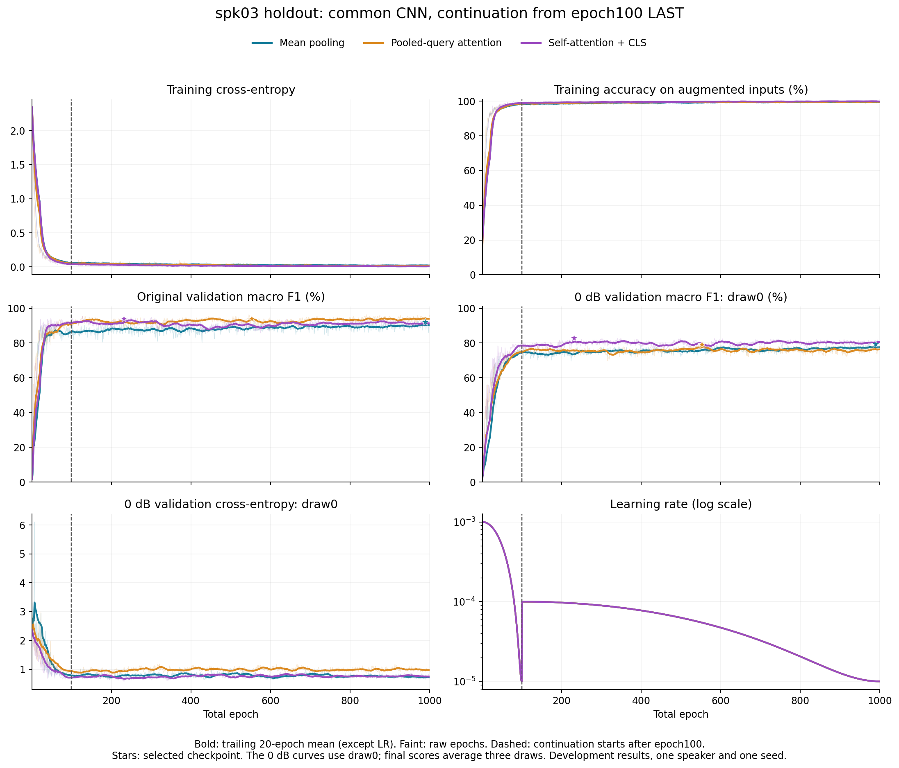

# 화자03 · 공통 CNN 3종 · 100→1000epoch 연장

총 1000epoch. 이전100epoch LAST 모델·AdamW 상태를 복원했다. 학습률은101epoch에서 0.0001로 재시작하고 cosine으로 1e-05까지 낮췄다.
학습 화자02·04·05 (609개), 검증 화자03 (203개). 기존 소음·포먼트 캐시와 평가 입력을 그대로 사용했다.

| 모델 | 100epoch 선택 0dB F1 | 연장 선택 epoch | 연장 선택 원본 F1 | 연장 선택 0dB F1 | 증감 | 최종 LAST 0dB F1 | 잡음 단독 오반응률 |
|---|---:|---:|---:|---:|---:|---:|---:|
| cnn_mean | 76.40% | 989 | 92.06% | 79.65% | +3.25pp | 77.71% | 20.62% |
| cnn_pooled_query | 76.32% | 553 | 94.13% | 78.76% | +2.44pp | 76.51% | 23.54% |
| cnn_self_cls | 79.40% | 231 | 94.10% | 82.89% | +3.49pp | 81.11% | 20.42% |

0dB draw0로 체크포인트를 선택하고 최종3draw로 평가했다. 과거100epoch의 선택 체크포인트도 후보에 포함했다. 개발 화자1명·seed1개 결과이며 독립 test 성능이 아니다. 학습률 재시작을 포함한 연장 효과다.

## 결과 해석

- 셀프 어텐션의 선택 모델0dB F1은79.40→82.89% (+3.49%p), 평균 풀링76.40→79.65%, 풀드 어텐션76.32→78.76%다.
- 셀프 어텐션의 선택 epoch는231이며1000epoch LAST의0dB F1은81.11%다. 오래 학습할수록 계속 개선되지는 않았다.
- 원본(추가 소음 없음)의 선택 모델 F1은 평균92.06%, 풀드94.13%, 셀프94.10%다. 별도로1000epoch LAST의 원본 F1은 평균89.63%, 풀드95.91%, 셀프92.32%다. 원본 녹음 자체가 완전 무잡음이라는 뜻은 아니다.
- 잡음 단독 오반응률은 평균19.17→20.62%, 풀드31.04→23.54%, 셀프13.33→20.42%다. 이 값은 잡음 입력을argmax로silence 이외 명령으로 분류한 비율이다. 셀프의 명령 분류 F1 개선이 잡음 거절 개선을 의미하지 않는다.
- 마지막20epoch 학습 정확도는 평균99.33%, 풀드99.57%, 셀프99.72%다. 추가 학습은 도움이 됐지만 이 결과만으로1000epoch 이후 큰 개선이나90% 달성을 예상하기 어렵다.
- 저장된 예측 CSV에서macroF1을 독립 재계산해 최종 결과를 검증했다. 학습률 재시작도 포함한 연장 효과다.

진한 선은20epoch 이동평균이며 별표는0dB draw0 선택 시점이다. 그래프의0dB는draw0, 위 표는3draw 평균이다.

[곡선 PDF](learning_curves.pdf) · [구간별 분석](learning_curve_analysis.json)

[기존 Conformer 비교 및 silence 학습·샘플링 차이](CONFORMER_COMPARISON.md)
