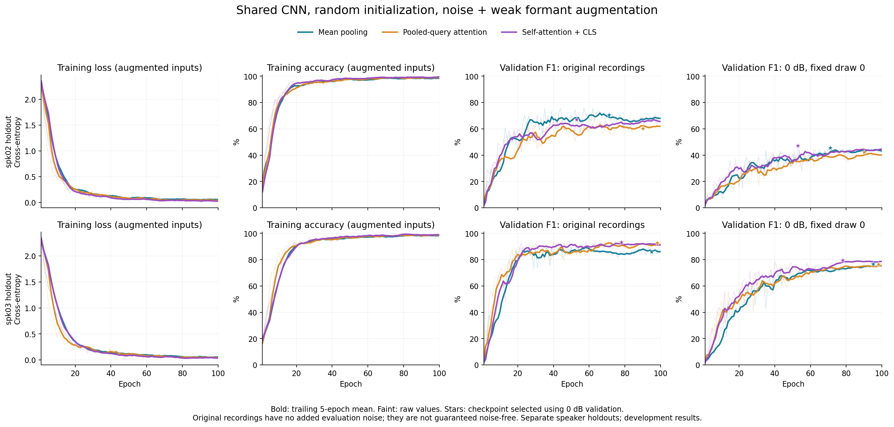

# 공통 CNN · 집계 방식 비교 · 증강 적용

학습 목적: ce

검출기/발화확률/사전학습 없이 전체 1.5초를 입력한다. 화자02·03 각각 홀드아웃하는 두 개발 분할이다.
소음 p=0.5, SNR [-5,20]dB + 약한 포먼트 p=0.5. 모델은 같은 CNN·분류기 초기값과 같은 증강 입력을 사용하고 독립 학습한다.

| 모델 | 파라미터 | 화자 | 선택 epoch | 원본 F1 | 0dB F1 (3draw) | 마지막 epoch 0dB F1 | 잡음 단독 오반응률 |
|---|---:|---|---:|---:|---:|---:|---:|
| cnn_mean | 77,835 | spk02 | 71 | 70.53% | 45.92% | 41.94% | 20.21% |
| cnn_pooled_query | 78,859 | spk02 | 90 | 60.14% | 41.42% | 39.33% | 22.92% |
| cnn_self_cls | 86,315 | spk02 | 53 | 67.00% | 47.25% | 45.39% | 36.67% |
| cnn_mean | 77,835 | spk03 | 95 | 85.93% | 76.40% | 75.41% | 19.17% |
| cnn_pooled_query | 78,859 | spk03 | 98 | 92.68% | 76.32% | 75.25% | 31.04% |
| cnn_self_cls | 86,315 | spk03 | 78 | 93.14% | 79.40% | 78.37% | 13.33% |

한 seed·개발 2분할의 선별 결과다. 0dB draw0로 체크포인트를 선택했고, 최종 3draw에도 draw0가 포함된다. 독립 test 성능이나 검출기 효과를 의미하지 않는다.
기존 4분할 Conformer 결과와는 모델·학습 초기화·전처리·검증 분할이 달라 직접적인 개선 수치로 해석할 수 없다.

상세 설정: protocol.json. 전체 epoch 기록·증강 추적·선택/최종 체크포인트·예측값은 runs/compact-pooling-v1 아래에 보존한다.

## 학습 곡선 분석

- 진한 선: 최근5epoch 평균. 옅은 선: 실제 epoch 값. 별표: 0dB draw0 기준으로 선택된 체크포인트.
- 곡선의 0dB는 epoch마다 평가한 draw0이며, 위 최종 표는3draw 평균이므로 수치가 약간 다르다.
- 추가 소음 없는 원본의 F1은 위 표의 원본 F1이다. 모델 선택은 원본 F1이 아니라0dB로 했으므로 원본 최고 epoch와 일치하지 않는다. 원본 녹음 자체가 완전 무잡음이라는 뜻은 아니다.
- 마지막20epoch 학습 정확도는98.3~99.2%다. 단순히 학습 데이터를 못 맞혀서 생긴 격차로 보기는 어렵다.
- 셀프 어텐션의0dB draw0 평균은61~80epoch→81~100epoch에서 화자02 41.51→44.07%, 화자03 75.38→78.57%로 개선됐다. 다만81~90→91~100에서는 화자02 44.11→44.03%, 화자03 78.56→78.58%로 거의 정체했다.
- 추가 학습 실험의 가치는 있지만 사전학습이 없다는 이유만으로100epoch가 부족하다고 결론 낼 수 없다. 특히 화자02는 원본 F1부터 낮아 화자 일반화 문제를 함께 다뤄야 한다.
- 현재 cosine 학습률은100epoch에서1e-5까지 낮아진다. 연장을 한다면 기존100epoch 결과는 보존하고 LAST 모델·optimizer에서 별도 학습률 정책으로 이어가며, 세 모델의 총 학습 예산을 맞춰 비교해야 한다.

[검증 곡선 확대](validation_curves.png) · [전체 곡선 PDF](learning_curves.pdf) · [수치 분석](learning_curve_analysis.json)
