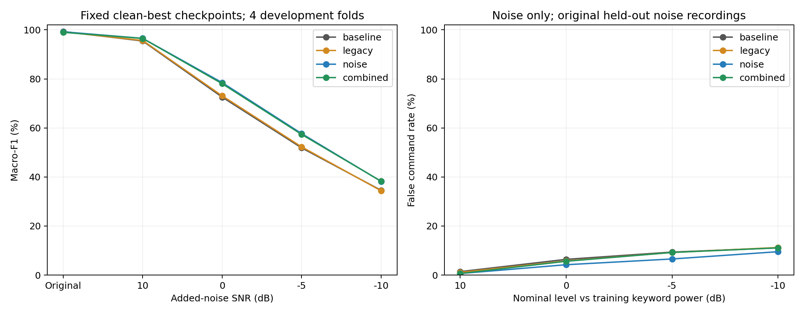
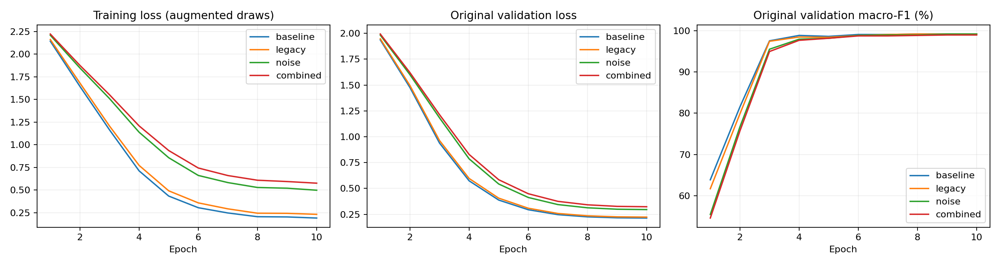

# Conformer 증강 비교

보조 음향 특징 없이 기존 Conformer에 속도·마스킹과 실제 훈련 소음 혼합을 비교했다. ref 데이터, 개발 화자 4-fold, seed42, 10epoch, 학습률·정규화·분류층은 유지했다. 무증강 4개는 기존 실행을 재사용하고 나머지 12개는 ASR 원본 가중치에서 각각 새로 학습했다.

| 훈련 조건 | 원본 F1 | 10dB | 0dB | −5dB | −10dB |
| --- | ---: | ---: | ---: | ---: | ---: |
| 무증강 | 99.32% | 95.46% | 72.57% | 51.88% | 34.56% |
| 속도+마스킹 | 99.20% | 95.65% | 73.09% | 52.29% | 34.37% |
| 소음 혼합 | 99.20% | 96.53% | 78.47% | 57.70% | 38.22% |
| 속도+마스킹+소음 | 98.98% | 96.50% | 78.05% | 57.35% | 38.27% |

원본은 4-fold 평균 macro-F1이다. 소음 점수는 4개 fold × 검증 원본 8개 × 추출 3회의 F1을 같은 가중치로 평균했다. 기존 스트레스 평가와 동일한 혼합 80,512개의 SHA256이 일치했다. 최종 test spk01은 이번에도 읽거나 추론하지 않았다.

이번 조건에서는 소음 혼합만 적용한 모델이 유망했다. 무증강 대비0dB에서+5.90%p,−10dB에서+3.66%p 높았고, 원본은−0.12%p였다. 속도+마스킹만으로는 개선이 작았고, 소음과 결합했을 때 추가 이득도 뚜렷하지 않았다. 이는 한 시드의 개발 결과이며 시드에 강건한 우열을 확정한 결과는 아니다.



## 적용한 증강

- 속도: 확률0.5, 피치를 유지하는0.9~1.1배. 파일마다 고정2개 변형을 준비하고 훈련 draw에서 선택한다. ref의 검수 비패딩 구간 전체를 보호하며 감속 후 넘치면 건너뛴다. 가속으로 부족한 길이만 가운데0패딩한다.
- 마스킹: 확률0.5, 시간20~50ms와 주파수3~5bin. 이전128-bin mel의4~8bin 폭을 현재80-bin에 맞춘 이식이다. native Fbank의 무음 값으로 채우며 평가에서는 완전히 비활성화한다.
- 소음: 확률0.5, SNR U[−5,20]dB. 도로·버스·광장·구내식당·콘크리트 믹서·펌프의 다른 원본6개에서 매번 새로운1.5초 연속 구간을 추출한다. 기존 검증 원본8개와 파일명·원본/준비파일 해시가 겹치지 않는다.
- 결합: 속도→소음→native Fbank 마스킹 순서이며 정책별 확률은 독립적이다. 조건 간 같은 화자·시드·학습 샘플과 가능한 증강 랜덤 스트림을 짝지었다.
- SNR: 현재 속도 변형 후 full-clip 파워 대비 추가 잡음 파워다. silence는 각 fold의 원본 훈련 명령어600개 RMS 중앙값 기준이다. 혼합 전체의 공통 감쇠로 clipping을 피한다.

속도 캐시의 명령어 변형 1600개 중 17개는 보호 구간이 넘쳐 건너뛰었다. 가속 후 추가0패딩은 최대 135.8ms다. 이는 훈련에서 실제 뽑힌 횟수와 구별한다. [속도 적용 감사](speed_application_audit.json)

## 원본 학습–검증 격차

같은 최고 checkpoint에서 원본 학습609개와 원본 검증203개를 eval 모드로 측정했다.

| 조건 | 학습 F1 | 검증 F1 | 격차 |
| --- | ---: | ---: | ---: |
| 무증강 | 99.66% | 99.32% | 0.34%p |
| 속도+마스킹 | 99.39% | 99.20% | 0.19%p |
| 소음 혼합 | 99.51% | 99.20% | 0.30%p |
| 속도+마스킹+소음 | 99.43% | 98.98% | 0.46%p |

소음 성능이 향상되더라도 원본의 학습–검증 격차 변화만으로 그 원인을 전부 과적합 감소라고 확정하지 않는다. 특히 무증강 Conformer는 원본 검증 성능이 이미 높아 원본 F1에 개선 여지가 작다. 원본 격차는 무증강0.34%p에서 소음 혼합0.30%p로 변화가 작았다. 이번에는 소음 조건에 대한 일반화 개선이 더 분명하게 관찰됐다.



곡선은 4개 fold 평균이다. 훈련 loss는 조건마다 다른 증강 입력에서 측정하므로 절댓값을 직접 비교해 과적합 순위를 매기지 않는다. [epoch별 평균](learning_curve_means.csv)

## 잡음만 입력했을 때 명령어 오반응률

| 조건 | 10dB | 0dB | −5dB | −10dB |
| --- | ---: | ---: | ---: | ---: |
| 무증강 | 1.41% | 6.41% | 9.38% | 11.09% |
| 속도+마스킹 | 1.09% | 5.78% | 9.22% | 11.25% |
| 소음 혼합 | 0.62% | 4.22% | 6.56% | 9.53% |
| 속도+마스킹+소음 | 0.62% | 5.62% | 9.22% | 11.09% |

각 검증 소음 원본에서20개 구간을 고정하고4개fold 모델에 같은 구간을 넣었다. 수준은 훈련 키워드 파워 기준의 명목 SNR이다.

## 한계와 선택 기준

- 최고 checkpoint는 원본 validation macro-F1로 선택하고 동점이면 먼저 나온 epoch를 사용했다. 잡음 검증 결과로 epoch를 고르지 않았다. 원본 성능이 일찍 포화되면 이후의 잡음 적응을 충분히 반영하지 못할 수 있다.
- 개발 화자4명·학습seed42 하나의 결과다. 조건과 기존 소음 종류는 개발 과정에서 확인한 자료이며 독립 최종 평가가 아니다. 새 소음6개가 모든 실제 환경을 대표하지 않는다. −10dB 검증은 이번 훈련 잡음 범위인−5~20dB보다 강한 조건이다.
- 속도는 파일별 고정2개 변형이고, 잡음은 매번 새로 추출한다. 마스킹은 기존 ResNet 입력과 완전히 같은 표현이 아니며 native80-bin에 맞게 이식했다.
- 거리·잔향·마이크왜곡·unknown 단어의 일반화는 이번 혼합 평가만으로 입증되지 않는다. 보조 특징은 아직 추가하지 않았다.

## 파일과 재현

[훈련 소음 출처](training_noise_sources.json) · [고정 프로토콜](protocol.json) · [실행별 결과](runs.csv) · [화자별 소음 결과](speaker_summary.csv) · [소음별 결과](noise_summary.csv) · [전체 예측](predictions.csv.gz) · [훈련 draw 기록](training_draws.csv.gz) · [평가 감사](evaluation_audit.json) · [독립 검증](independent_audit.json) · [검증 기록](VALIDATION.md)

[소음 강도별 듣기 예시](../noise-stress-v1/README.md#직접-듣기)는 이전 평가와 같은 입력이다.

훈련 소음 출처: [DEMAND](https://zenodo.org/records/1227121), Joachim Thiemann·Nobutaka Ito·Emmanuel Vincent; [RPi](https://zenodo.org/records/7493820), Gaurav Govilkar·Kader BT Shaikh·N Gopalkrishnan. DEMAND 설명/PDF는CC BY-SA3.0·API는CC BY4.0, RPi API는CC BY4.0. DEMAND는ch01을 사용하며 RPi는mono16k 사본으로 변환했다. 원배포 MD5와 준비 파일SHA256을 기록했다.

```bash
OMP_NUM_THREADS=2 MKL_NUM_THREADS=2 OPENBLAS_NUM_THREADS=1 runs/conformer-env/bin/python -m experiments.conformer_aug.run
OMP_NUM_THREADS=2 MKL_NUM_THREADS=2 OPENBLAS_NUM_THREADS=1 runs/conformer-env/bin/python -m experiments.evaluate_conformer_aug
runs/conformer-env/bin/python -m experiments.report_conformer_aug
OMP_NUM_THREADS=2 MKL_NUM_THREADS=2 OPENBLAS_NUM_THREADS=1 runs/conformer-env/bin/python -m experiments.check_conformer_aug
```

실행로그·원본 가중치·재개 checkpoint는 `runs/conformer-aug-v1/`에 있다. 기존 완료 연구의 코드·보고서·음성을 덮어쓰지 않았다.
