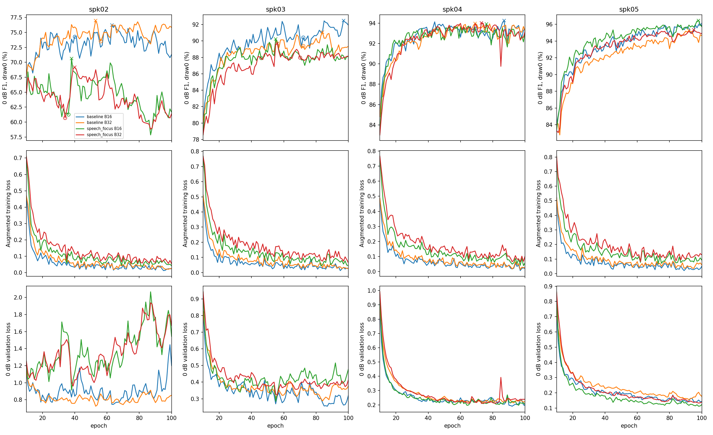

# 조기 종료 없이 100epoch까지 연장

상태: complete, 결과 정리 16/16분기.

이전 조기 종료 9분기를 마지막 checkpoint의 모델·AdamW·RNG에서 이어 학습한다. 이미100epoch인 7분기는 재사용한다.
변경은 조기 종료 제거 하나다. 학습률·배치·증강·609draw/epoch·고정 검증 파형은 유지한다.
최고본 선택은 기존과 같은 무필터0dB 고정draw0 F1이며 이전 최고본도 후보에 포함한다. 마지막 모델은 모두100epoch다.
최종 평가는 원본·0dB 전체3draw·잡음단독, DFN3 off/on. 개발 검증 결과이며 test01은 사용하지 않는다.

[진행상태](progress.json) · [실행 로그](../../runs/conformer-fixed100-v1/execution.log) · [고정 설정](protocol.json)

○는 이전 종료점, ×는 현재까지 최고 F1이다. 미완료 분기는 진행된 epoch까지 표시한다.

| 증강 | 배치 | 모델/필터 | 원본 F1 | 원본 정확도 | 0dB F1 | 0dB 정확도 | 이전 대비0dB F1 |
|---|---:|---|---:|---:|---:|---:|---:|
| baseline | 16 | best_dfn3 | 98.06% | 97.91% | 89.49% | 89.63% | +0.99%p |
| baseline | 16 | best_off | 99.66% | 99.63% | 89.75% | 90.19% | +0.85%p |
| baseline | 16 | last_dfn3 | 97.95% | 97.78% | 89.56% | 89.77% | +0.40%p |
| baseline | 16 | last_off | 99.66% | 99.63% | 87.92% | 88.53% | -0.45%p |
| baseline | 32 | best_dfn3 | 97.95% | 97.78% | 88.70% | 88.73% | +0.07%p |
| baseline | 32 | best_off | 99.54% | 99.51% | 89.13% | 89.73% | +0.16%p |
| baseline | 32 | last_dfn3 | 97.14% | 96.92% | 88.69% | 88.81% | +0.00%p |
| baseline | 32 | last_off | 99.66% | 99.63% | 88.24% | 89.13% | +0.42%p |
| speech_focus | 16 | best_dfn3 | 97.96% | 97.78% | 88.90% | 89.18% | +1.04%p |
| speech_focus | 16 | best_off | 99.32% | 99.26% | 87.86% | 88.63% | +1.10%p |
| speech_focus | 16 | last_dfn3 | 97.34% | 97.41% | 88.18% | 88.76% | -0.12%p |
| speech_focus | 16 | last_off | 98.66% | 99.14% | 84.69% | 85.90% | +0.19%p |
| speech_focus | 32 | best_dfn3 | 97.73% | 97.54% | 88.74% | 88.96% | +0.68%p |
| speech_focus | 32 | best_off | 99.32% | 99.26% | 86.89% | 87.73% | +0.37%p |
| speech_focus | 32 | last_dfn3 | 97.37% | 97.17% | 88.23% | 88.64% | +0.18%p |
| speech_focus | 32 | last_off | 99.16% | 99.38% | 84.17% | 84.98% | +0.05%p |

표는 4fold가 모두 완료된 조건만 표시한다. 추가 학습으로 최고점 탐색 범위도 늘어나므로 개발 점수 상승이 독립 test 개선을 보장하지 않는다.

