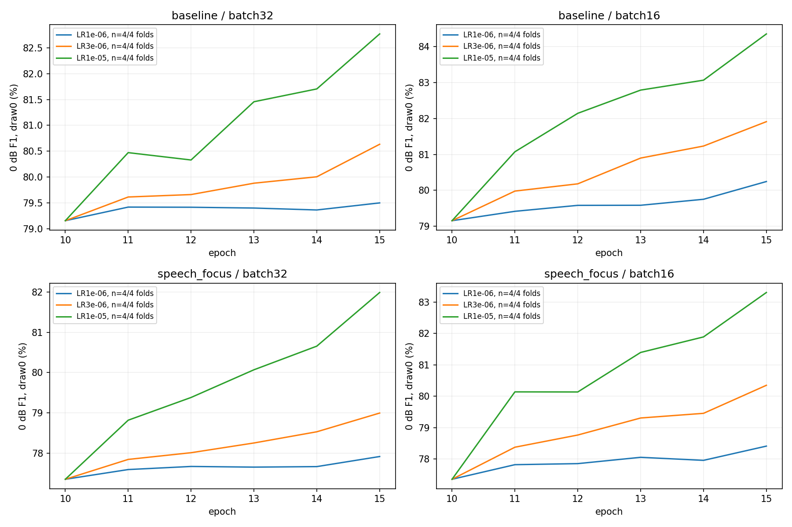
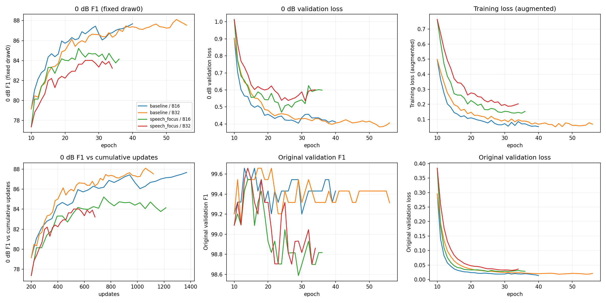
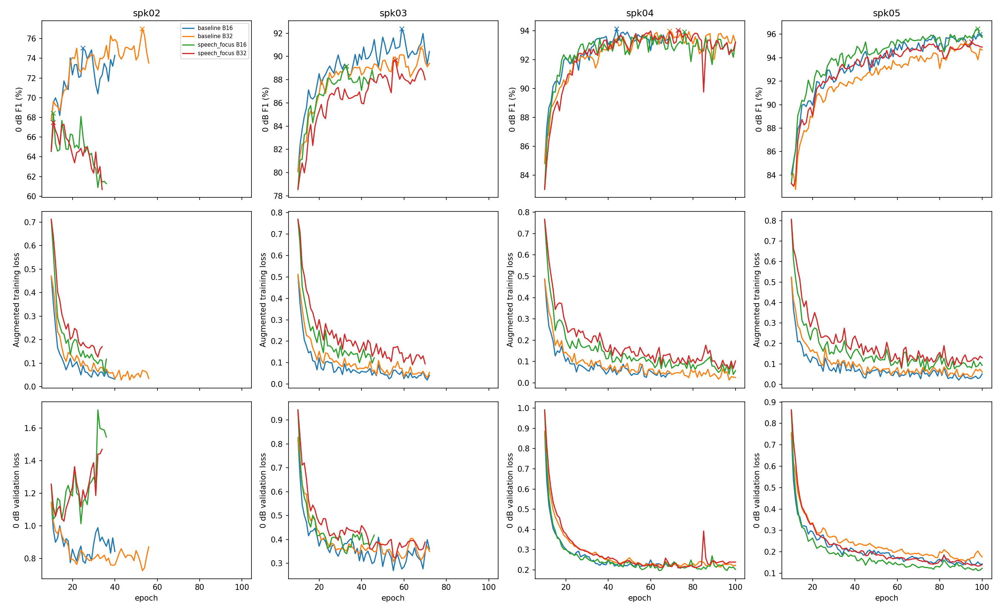

# 0dB 기준 연장 학습·배치16/32·학습률 비교

상태: `complete`. pilot 48/48, 긴 학습 16/16 완료.

기존 noise와 speech_focus의 epoch10 마지막 모델·AdamW 모멘텀·sampler/RNG에서 이어서 학습한다. 원래10epoch cosine을 연장하지 않고 epoch11부터 고정LR을 쓴다.
배치32/16 모두609draw/epoch이며 업데이트는20/39번이다. 첫10epoch는 모두batch32로200update였다. 배치마다LR을 선택하므로 최종비교는 튜닝된 설정 간 비교다.

LR 후보: 인코더1e-6/3e-6/1e-5, head는50배. 각조건·배치에서4fold의epoch13~15 평균0dB F1로 선택한다(동점은낮은손실→낮은LR).
매epoch0dB 모니터는 평가8원본×고정draw0×203개/화자(1,624혼합)이며 원본203개도 별도로 기록한다. 최고epoch는 DFN없는0dB F1로 고른다.
최종은 선택best·마지막last·시작epoch10 모두 기존전체3draw 0dB·원본·잡음단독과 DFN3 off/on으로 평가한다. 추가draw도개발평가이며독립test가아니다.

과적합 표시: 최소25epoch 이후3epoch평균에서 과거최저검증손실 대비 검증손실≥3%증가·훈련손실≥2%감소·과거최고F1대비≥0.5%p하락이5회연속이면확인시점을기록하고5epoch더남긴다. 단순정체로중단하지않는다. 최대100epoch에서도조건이안나오면‘과적합미확인’이다.

0dB 소음과 개발화자02~05를 epoch/LR 선택에 사용한다. 아래점수는튜닝에사용한개발결과다. test01오디오/추론은사용하지않는다. 기존실험파일은보존한다.

실시간 상태: [progress.json](progress.json), [실행 로그](../../runs/conformer-long-zero-v1/execution.log), [고정 설정](protocol.json).

## 짧은 학습률 비교

진행중에는완료화자수가후보마다다를수있으므로범례n/4를확인한다. 최종LR은모두4fold가끝난뒤선택한다.

## 선택 학습률

| 증강 | 배치 | 인코더LR | headLR | pilot 0dB F1 |
|---|---:|---:|---:|---:|
| baseline | 32 | 1e-05 | 5.0e-04 | 81.98% |
| baseline | 16 | 1e-05 | 5.0e-04 | 83.40% |
| speech_focus | 32 | 1e-05 | 5.0e-04 | 80.90% |
| speech_focus | 16 | 1e-05 | 5.0e-04 | 82.20% |

pilot F1은4fold×마지막3epoch 평균이며 전체3draw 최종평가와 구간수가 다르다.

## 학습곡선

평균곡선은4fold가모두있는epoch만사용한다. 진행중이거나조기종료된fold가있으면개별곡선을함께본다. epoch10의훈련손실은이전실험값이다.

화자별 전체 에포크의 0dB F1·증강 훈련 손실·0dB 검증 손실이다. ×는 최고 F1 지점이다. 훈련과 검증의 입력 분포가 다르므로 손실 절댓값의 차이보다 각 곡선의 변화 방향을 확인한다.

## 이어 학습하기 전 epoch10

이전공식표는원본검증clean-best였고여기는epoch10 LAST다. 시작점차이와연장효과를구분한다.

| 증강 | 필터 | 전체0dB F1 | 원본 F1 |
|---|---|---:|---:|
| baseline | dfn3 | 83.95% | 95.68% |
| baseline | off | 79.16% | 99.20% |
| speech_focus | dfn3 | 84.03% | 95.67% |
| speech_focus | off | 77.57% | 99.09% |

## 전체3draw 결과(완료된4fold만 평균)

| 증강 | 배치 | 체크포인트/필터 | 0dB F1 | 원본 F1 | 잡음단독 오반응 |
|---|---:|---|---:|---:|---:|
| baseline | 16 | best_dfn3 | 88.50% | 97.72% | 11.41% |
| baseline | 16 | best_off | 88.89% | 99.66% | 3.12% |
| baseline | 16 | last_dfn3 | 89.16% | 97.96% | 9.22% |
| baseline | 16 | last_off | 88.37% | 99.66% | 0.62% |
| baseline | 32 | best_dfn3 | 88.63% | 97.84% | 10.78% |
| baseline | 32 | best_off | 88.97% | 99.54% | 2.81% |
| baseline | 32 | last_dfn3 | 88.68% | 97.36% | 10.31% |
| baseline | 32 | last_off | 87.82% | 99.43% | 1.25% |
| speech_focus | 16 | best_dfn3 | 87.87% | 97.73% | 5.94% |
| speech_focus | 16 | best_off | 86.77% | 99.43% | 0.62% |
| speech_focus | 16 | last_dfn3 | 88.30% | 97.62% | 3.44% |
| speech_focus | 16 | last_off | 84.50% | 98.82% | 0.00% |
| speech_focus | 32 | best_dfn3 | 88.07% | 97.50% | 6.25% |
| speech_focus | 32 | best_off | 86.52% | 99.55% | 0.94% |
| speech_focus | 32 | last_dfn3 | 88.04% | 97.27% | 4.53% |
| speech_focus | 32 | last_off | 84.13% | 98.97% | 0.47% |

best는DFN없는고정draw0로고른동일checkpoint이며off/DFN3를각자최적epoch로고르지않는다. last는중단시점이다.

## 종료 시점

| 증강 | 배치 | 화자 | 최고epoch | 마지막epoch | 악화신호탐지epoch | 후속 관찰 |
|---|---:|---|---:|---:|---:|---|
| baseline | 16 | spk02 | 25 | 40 | 35 | 악화신호관측 |
| baseline | 16 | spk03 | 59 | 72 | 67 | 악화신호관측 |
| baseline | 16 | spk04 | 44 | 69 | 64 | 후속창에서악화신호비지속 |
| baseline | 16 | spk05 | 99 | 100 | None | 지속과적합미확인 |
| baseline | 32 | spk02 | 53 | 56 | 51 | 탐지후F1최고점재갱신 |
| baseline | 32 | spk03 | 68 | 72 | 67 | 탐지후F1최고점재갱신 |
| baseline | 32 | spk04 | 69 | 100 | None | 지속과적합미확인 |
| baseline | 32 | spk05 | 92 | 100 | None | 지속과적합미확인 |
| speech_focus | 16 | spk02 | 11 | 36 | 31 | 악화신호관측 |
| speech_focus | 16 | spk03 | 33 | 46 | 41 | 악화신호관측 |
| speech_focus | 16 | spk04 | 76 | 100 | None | 지속과적합미확인 |
| speech_focus | 16 | spk05 | 98 | 100 | None | 지속과적합미확인 |
| speech_focus | 32 | spk02 | 11 | 34 | 29 | 악화신호관측 |
| speech_focus | 32 | spk03 | 56 | 70 | 65 | 악화신호관측 |
| speech_focus | 32 | spk04 | 73 | 100 | 95 | 악화신호관측 |
| speech_focus | 32 | spk05 | 95 | 100 | None | 지속과적합미확인 |

탐지는미리정한운영상종료기준이다. 후속5epoch에서회복하거나새최고점을찍을수있으므로탐지epoch를‘이후계속과적합’의증거로단정하지않는다. 후속회복여부와전체곡선을함께해석한다.

독립검사: [independent_audit.json](independent_audit.json).

최종기준비교·추가구간확인: [RESULTS.md](RESULTS.md).
