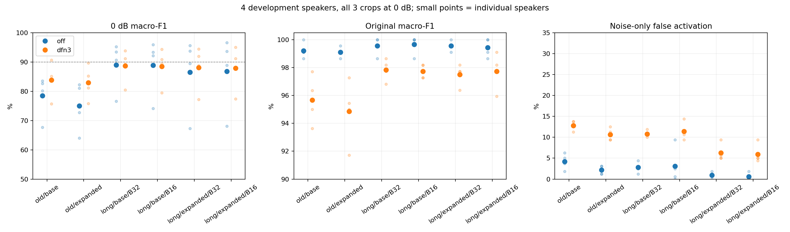

# 0dB 기준 연장 학습 최종 비교

기존 10에포크의 원본 검증 최고본, 재개 출발점인 10에포크 마지막 모델, 0dB 기준 연장 학습 최고본을 같은 4화자·8소음·3구간에서 비교했다.
에포크 수와 함께 학습률 스케줄, 최고본 선택 기준도 바뀌었다. 배치 16은 에포크당 업데이트가 더 많다. 아래 점수 차이는 각 설정을 함께 적용한 결과다.

| 학습 | 배치 | 0dB F1 | +DFN3 | 원본 F1 | 원본+DFN3 | 소음단독 오반응 | +DFN3 |
|---|---:|---:|---:|---:|---:|---:|---:|
| 10에포크 원본 최고본 · 기존 증강 | 32 | 78.47% | 83.80% | 99.20% | 95.68% | 4.22% | 12.81% |
| 10에포크 원본 최고본 · 말소리·0dB 강화 | 32 | 75.03% | 82.95% | 99.09% | 94.85% | 2.19% | 10.62% |
| 10에포크 마지막 · 기존 증강 | 32 | 79.16% | 83.95% | 99.20% | 95.68% | 4.53% | 12.66% |
| 10에포크 마지막 · 말소리·0dB 강화 | 32 | 77.57% | 84.03% | 99.09% | 95.67% | 2.03% | 10.78% |
| 연장 최고본 · 기존 증강 | 32 | 88.97% | 88.63% | 99.54% | 97.84% | 2.81% | 10.78% |
| 연장 최고본 · 기존 증강 | 16 | 88.89% | 88.50% | 99.66% | 97.72% | 3.12% | 11.41% |
| 연장 최고본 · 말소리·0dB 강화 | 32 | 86.52% | 88.07% | 99.55% | 97.50% | 0.94% | 6.25% |
| 연장 최고본 · 말소리·0dB 강화 | 16 | 86.77% | 87.87% | 99.43% | 97.73% | 0.62% | 5.94% |

## 종료 체크포인트의 보조 비교

종료 시점은 무필터 0dB 추세와 100에포크 상한으로 정했다. 아래는 그 종료본을 평가한 결과다.

| 학습 | 배치 | 0dB F1 | +DFN3 |
|---|---:|---:|---:|
| 기존 증강 | 32 | 87.82% | 88.68% |
| 기존 증강 | 16 | 88.37% | 89.16% |
| 말소리·0dB 강화 | 32 | 84.13% | 88.04% |
| 말소리·0dB 강화 | 16 | 84.50% | 88.30% |

전체 비교표의 최고 관측값은 기존 증강·배치 16·long_last·dfn3의 **89.16%**다. 이 값도 개발 데이터 비교 결과이며 DFN3 기준으로 에포크를 별도 최적화한 실험은 아니다.

첫 표의 ‘연장 최고본’은 DFN3 없이 고정된 첫 구간의 0dB F1로 선택했다. DFN3 열은 그 동일한 모델에 필터를 적용한 결과다.
배치 32·16 모두 한 에포크에 609개를 추출하며, 업데이트는 각각 20·39회다. 분기마다 종료 에포크도 다르다. [같은 에포크 비교](common_epoch_summary.csv)와 [누적 업데이트 수](endpoint_table.csv)를 함께 확인할 수 있다.

[선택 구간과 추가 두 구간](draw_split_summary.csv)은 같은 개발 화자·소음 원본의 다른 구간이다. 이번 LR·에포크 선택에는 첫 구간만 사용했으며, 추가 구간도 독립 시험셋은 아니다. 이번 실험에서 test01 오디오는 읽거나 추론하지 않았다.

[화자별 결과](speaker_comparison.csv), [소음별 결과](noise_summary.csv), [출발점 대비 정답·오답 변화](paired_error_changes.csv), [모든 비교 지표](comparison.csv). 정답·오답 개수는 반복 혼합 평가 건수이며 고유 발화 개수가 아니다.

[학습곡선과 종료 후 회복 해석](README.md), [독립 검사](independent_audit.json), [검증·재개 방법](VALIDATION.md).
