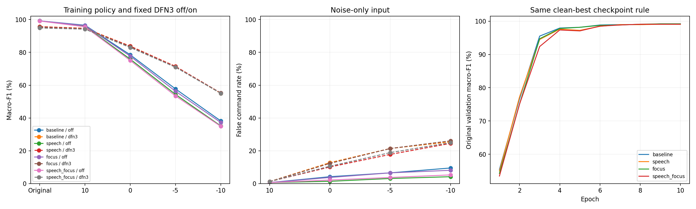

# 말소리 소음 확대·0dB 학습 비중·DFN3 비교

사용자 요청에 따라 기존 원본/넓은 SNR 학습을 유지하면서 말소리 소음과0dB 부근 입력 비중을 늘렸다. 두 변경을 각각/함께 적용한 모델을 새로 학습하고, 기존 소음 혼합 모델과 모두 DFN3 off/on으로 비교했다.

## 0dB 결과

| 학습 조건 | DFN3 | 원본 F1 | 0dB F1 | 기존 동일 경로 대비 | 잡음 단독 오반응 |
| --- | --- | ---: | ---: | ---: | ---: |
| 기존 소음 혼합 | off | 99.20% | 78.47% | +0.00%p | 4.22% |
| 기존 소음 혼합 | dfn3 | 95.68% | 83.80% | +0.00%p | 12.81% |
| 말소리 소음 추가 | off | 99.20% | 75.84% | -2.63%p | 1.41% |
| 말소리 소음 추가 | dfn3 | 95.68% | 83.74% | -0.06%p | 10.16% |
| 0dB 부근 비중 증가 | off | 99.20% | 77.67% | -0.81%p | 3.75% |
| 0dB 부근 비중 증가 | dfn3 | 95.33% | 83.32% | -0.48%p | 12.34% |
| 둘 다 적용 | off | 99.09% | 75.03% | -3.44%p | 2.19% |
| 둘 다 적용 | dfn3 | 94.85% | 82.95% | -0.85%p | 10.62% |

이번 개발 검증의 0dB 평균 macro-F1 최고는 **기존 소음 혼합 / dfn3** (83.80%)다. 원본 성능과 잡음 단독 오반응도 함께 판단한다. 가장 높은 한 수치만으로 실제 운용 조건을 확정하지 않는다.

이번 비율에서는 새 학습3조건 모두0dB F1이 기존 동일 경로보다 높아지지 않았다. 말소리 추가+DFN3는83.74%로 기존+DFN3의83.80%와 비슷했고, 잡음 단독 오반응은12.81→10.16%로 낮았다. DFN3 없이 말소리만 추가하면 실제 명령어 무음 누락이3.16→8.77%로 늘어 F1 하락과 동반됐다. 기본 학습 조건을 새 결합 조건으로 자동 교체하지 않았다.

원본은 개발4-fold 평균, 혼합 점수는 fold4×검증 소음 원본8×추출3의 11-class macro-F1을 같은 가중치로 평균했다. 서로 다른 발화 원본은812개이며 여러 소음 조건으로 반복 평가했다. 이번 비교에 test01 오디오를 읽거나 추론하지 않았다.

## 0dB의 명령어 누락

| 학습 조건 | DFN3 | 실제 명령어 정답률 | 실제 명령어를 무음으로 놓침 |
| --- | --- | ---: | ---: |
| 기존 소음 혼합 | off | 79.36% | 3.16% |
| 기존 소음 혼합 | dfn3 | 83.20% | 0.16% |
| 말소리 소음 추가 | off | 76.69% | 8.77% |
| 말소리 소음 추가 | dfn3 | 83.04% | 0.22% |
| 0dB 부근 비중 증가 | off | 78.36% | 3.53% |
| 0dB 부근 비중 증가 | dfn3 | 82.88% | 0.17% |
| 둘 다 적용 | off | 75.88% | 7.45% |
| 둘 다 적용 | dfn3 | 82.43% | 0.23% |

잡음 단독 오반응 감소와 실제 명령어 누락 증가가 함께 나타나는지 구분한다. 현재 수치만으로 필터나 증강이 개선됐다고 한 방향으로 판단하지 않는다. 누락은 실제 명령어 입력 중 silence로 예측한 비율이며, 잡음 단독 입력의 오반응과 다른 지표다.

## 학습 분포

- 모든 조건의 원본 입력 확률50% 유지. 소음 확률50%,609draw/epoch,10epoch로 학습량도 같다.
- 기존: 소음일 때SNR U[-5,20]dB. 훈련 원본6개에서 균등 선택.
- 말소리 추가: 소음 draw의50%는 기존6개,50%는 추가 말소리 파일. 웅성거림/옆 사람 말소리/방송 유형을 균등 선택한 뒤 파일 균등 선택.
- 0dB 비중 증가: 소음 draw의50%는 기존U[-5,20],50%는U[-3,3]. 전체 입력으로는 원본50/넓은SNR25/0dB부근25%의 혼합 분포.
- 둘 다: 말소리 선택과SNR 선택을 독립 적용. 기존과 같은 학습 샘플·소음 적용 여부·기본 소음/SNR 랜덤 스트림을 짝지었다.
- 총학습량 고정 비교이므로 추가 말소리/near-zero가 일부 기존 소음 draw를 대체한다. 기존 소음 노출 횟수까지 보존한 추가 학습의 효과는 따로 측정하지 않았다.
- ref의16kHz·1.5초, 초기 한국어ASR 인코더/동일seed42 head, LR1e-5/5e-4,WD1e-4,encoder dropout.1,cosine10epoch 유지. 속도·마스킹·보조 특징 없음.
- epoch는 기존과 같은 원본 validation F1로 선택. 각 학습 조건에서 DFN3 off/on에 같은 checkpoint를 사용했다. DFN3는 훈련에서 사용하지 않았으며, 고정된 범용 전처리의 추론 효과만 비교했다.

실제 적용 비율은 [augmentation_rates.csv](augmentation_rates.csv), 모든 훈련 draw는 [training_draws.csv.gz](training_draws.csv.gz)에 기록했다.

## SNR별 F1

| 학습 조건 | DFN3 | 10dB | 0dB | −5dB | −10dB |
| --- | --- | ---: | ---: | ---: | ---: |
| 기존 소음 혼합 | off | 96.53% | 78.47% | 57.70% | 38.22% |
| 기존 소음 혼합 | dfn3 | 94.68% | 83.80% | 71.41% | 54.97% |
| 말소리 소음 추가 | off | 95.86% | 75.84% | 54.36% | 35.17% |
| 말소리 소음 추가 | dfn3 | 94.52% | 83.74% | 71.44% | 55.24% |
| 0dB 부근 비중 증가 | off | 96.31% | 77.67% | 56.29% | 37.26% |
| 0dB 부근 비중 증가 | dfn3 | 94.32% | 83.32% | 71.01% | 55.22% |
| 둘 다 적용 | off | 95.59% | 75.03% | 53.43% | 34.90% |
| 둘 다 적용 | dfn3 | 94.12% | 82.95% | 70.95% | 54.98% |

## 자료 분리와 해석 범위

추가 파일은 [공식 MS-SNSD](https://github.com/microsoft/MS-SNSD)의train Babble/NeighborSpeaking/AirportAnnouncements37개,약45.75분이다. MS-SNSD에 포함된 CafeTeria/Restaurant/Station 등의DEMAND 이름변경 원본은 사용하지 않았다. Git revision/blob과원본/준비파일/PCM 해시를 고정했다. 번호가 다른 파일들의 녹음 세션 독립성은 확인되지 않았으므로37개 독립 원본 세션이라고 주장하지 않는다.

검증8원본과 파일명·원본/준비해시가 겹치지 않으며, 처음/중간/끝8초를 상관도 검색해 뚜렷한 재인코딩 복제를 점검했다. 높은 저주파 상관 사례는 음성 대역에서 재확인했다. 이 검사가 모든 부분 중복이나 외부 사전학습 자료 중복 부재를 증명하지는 않는다.

기존 혼합80,512개는 SHA256까지 일치한다. 원본812개를 포함한 입력81,324개에 학습4조건×DFN3 off/on,총650,592예측이다. 이전DFN3 원본/0dB 출력20,940개를 그대로 재사용했다. DFN3 입력은 혼합 음성뿐이며 깨끗한 원본/분리된 잡음/라벨을 주지 않았다.

0dB는 원래1.5초 전체 파형 파워 대비 추가 잡음이다. silence/잡음 단독은 fold 훈련600개 명령어 RMS 중앙값 기준이다. DFN3는 공식48k 왕복 리샘플·지연 보정을 유지했고, 임의 피크 정규화/클리핑/원본과의 혼합을 추가하지 않았다.

훈련seed1개·개발 화자4명에서 조건을 고른 개발 결과다. 최종test나새녹음 일반화를 확정하지 않는다. 프로젝트 과거 브랜치의 test 사용 이력과 이번 실행의 test 미사용은 구분한다.

원본 validation F1로 epoch를 선택하므로0dB의 최적 epoch를 직접 선택한 실험은 아니다. 0dB 비중과 새로운 소음의 적정 비율·필요 학습량도 이번 한 설정으로 확정하지 않는다. 추가 배경 음성의 전사와 동일 한국어 키워드 포함 여부는 검수하지 않았다.

[고정 프로토콜](protocol.json) · [소음별 결과](noise_summary.csv) · [화자별 결과](speaker_summary.csv) · [독립 검사](independent_audit.json) · [검증·재개 방법](VALIDATION.md) · [듣기 샘플](../../runs/conformer-noise-focus-v1/listening/README.md)
