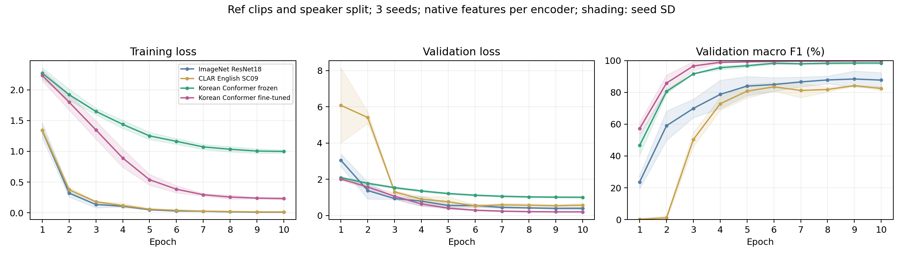

# ref 기준: 한국어 Conformer 전이 실험

ref fixed-1p5-v1의 원래16kHz·1.5초 음성과 train609(spk02/03/04) / validation203(spk05)를 사용했다. test203(spk01)은 추론하지 않았다. 보조 특징·증강 없이3시드42/43/44, 각10epoch다.

## 구조와 실제 입력

[공개 한국어 모델](https://huggingface.co/speechbrain/asr-conformer-transformerlm-ksponspeech)의 고정 버전 `ecb74648052c89618cd1ce53ccbc909d1141f164`다. KsponSpeech965.2시간으로 학습된 CNN 앞단·12층 Conformer 인코더를 사용하고 ASR 디코더·언어 모델 대신 평균 풀링과 새256→11층을 붙였다. 본체의406개 텐서를 모두 strict load했다. 전체32,122,699개 파라미터이며 동결 조건은2,827개만 학습한다.

원래80-bin Fbank·FFT400·25ms창·10mshop·f_min0과 사전학습 global 정규화 통계를 사용한다. 타깃 데이터로 정규화 통계를 갱신하지 않는다. 실제 `[2,24000]` 입력은 `[2,151,80]` 특징 → `[2,38,256]` 인코더 출력 → `[2,11]` logits가 된다. 추가 오디오 패딩은0이며1초 입력도 통과했다.

## 학습 조건

- 고정: CNN·인코더 eval+동결, 분류층 LR5e-4.
- 미세조정: CNN·인코더 LR1e-5, 분류층 LR5e-4, 원 모델 Dropout0.1 활성.
- 공통: AdamW WD1e-4, cosine10epoch, batch32, 역빈도 weighted replacement sampler로 epoch당609개.
- 같은 시드 두 조건의 초기 인코더와 분류층은 동일하다. 각 실행의 검증 macro-F1 최고 epoch를 선택한다.
- ImageNet와 CLAR 값은 이전 `speech-pretrain-ref-v1`에서 같은 데이터·분할·3시드로 측정한 대조군이다.

## 실행별 최고 checkpoint의3시드 평균

| 모델 | 검증 F1 | 정확도 | 학습 원본 F1 | 학습–검증 F1 격차 |
| --- | ---: | ---: | ---: | ---: |
| ImageNet ResNet18 | 89.26% | 88.34% | 100.00% | 10.74%p |
| CLAR English SC09 | 85.21% | 84.73% | 99.60% | 14.39%p |
| Korean Conformer frozen | 98.48% | 98.36% | 96.77% | -1.70%p |
| Korean Conformer fine-tuned | 99.85% | 99.84% | 99.46% | -0.39%p |

Conformer 중 평균 최고 조건은 **Korean Conformer fine-tuned**, ImageNet 대비 **+10.59%p**다.

| 시드 | ImageNet | Conformer 고정 | Conformer 미세조정 |
| --- | ---: | ---: | ---: |
| [42](seed42_files.md) | 92.38% (e9) | 98.63% (e7) | 100.00% (e6) |
| [43](seed43_files.md) | 90.15% (e9) | 99.09% (e6) | 100.00% (e9) |
| [44](seed44_files.md) | 85.25% (e8) | 97.71% (e6) | 99.55% (e6) |

## 3시드 평균에서 공통 epoch 하나를 선택

| 모델 | 공통 epoch | 평균 검증 F1 |
| --- | ---: | ---: |
| ImageNet ResNet18 | 9 | 88.43% |
| CLAR English SC09 | 9 | 84.25% |
| Korean Conformer frozen | 9 | 98.48% |
| Korean Conformer fine-tuned | 9 | 99.85% |

## 해석 범위

- 본체 구조·모델 크기·원래 입력 특징·사전학습 언어·미세조정 학습률이 함께 바뀐 시스템 비교다. 차이를 한국어라는 조건 하나의 효과로 해석할 수 없다.
- 단일 검증 화자203개를 조건·epoch 선택에 사용한 개발 결과다.3시드는 같은 파일을 반복하며 독립 화자3명이 아니다. 이 결과만으로 새로운 화자 전체에 같은 성능을 보장할 수 없다.
- 고정 조건에서는 인코더 Dropout이 비활성이고 미세조정에서는 활성이다. 두 조건의 차이는 학습률 하나만의 효과가 아니다.
- 기존 ref의 원래 단일seed42 F1 92.58%와 이번 대조군3시드 평균89.26%는 집계가 다르다.

- SpeechBrain1.0.3은 CUDA matmul TF32를 활성화한다. 기존 대조군은 PyTorch 기본 matmul TF32 off였다. 양쪽 CuDNN TF32는 on이며 모델 교체 외 수치 설정도 완전히 같은 통제는 아니다.

## 검증 및 산출물

새6회·60epoch와 기존6회·60epoch, 총24,360개 epoch 예측 행의 지표를 다시 계산했다. 원본1,015개 해시·선택 checkpoint 해시·동결 본체 보존·정규화 통계 보존·초기 분류층 일치를 확인했다. 새6개 최고 checkpoint를 실제 모델로 재구성해 학습·검증 4,872개 예측을 재추론했고 모두 일치했다.

[프로토콜](protocol.json), [실제 입력 확인](input_probe.json), [실행별 요약](run_summary.csv), [짝 비교](paired_summary.csv), [학습 기록](all_epoch_history.csv), [체크포인트 재추론](checkpoint_replay.json), [검증 기록](execution_audit.json).

