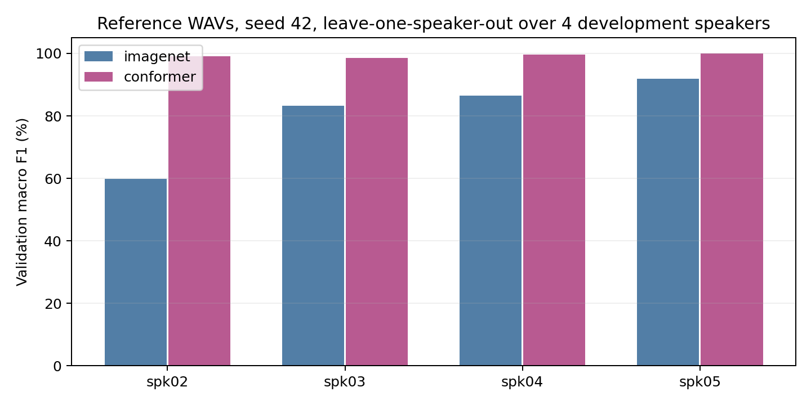

# Conformer 성능 과대평가 점검

기존99.85%는spk05 한 명의203개 검증 파일을3시드로 평가한 평균 macro-F1이다. 화자 일반화 확인을 위해 ref의 동일1.5초 WAV를 개발 화자02–05에서4-fold로 재분할했다. 각fold는 학습609·검증203이며 test spk01은 추론하지 않았다.

## 먼저 모델 설명 정정

이전에 제시한 Conv2개+Transformer6층·512→11·약2,060만이라는 표는 **Whisper-base** 설명이다. 실제99.85% 모델은 CNN3블록+Conformer12층·256→11·32,122,699개 파라미터다.

## 누수와 평가 검사

- 학습·검증812개: 화자·group·원본SHA·파일명 교집합0, 파일/PCM 정확 중복0.
- 모델은 파형만 받는다. 라벨·파일 경로는 모델 입력이 아니다. 정규화는 원래 사전학습 통계로 고정돼 있다.
- 기존6개 checkpoint 재추론4,872개는 저장 예측과 일치했다. 이번 CV8개 실행의80epoch 예측16,240개도 재계산했다.
- 정확 해시 검사는 변형·근사 중복까지 배제하지 않는다. 실제 화자 identity는 기존 metadata를 신뢰한다.
- KsponSpeech 전체 원음과의 직접 중복 대조는 하지 못했다. 사전학습 데이터 오염을 완전히 배제했다는 결론은 아니다.

## 입력 대조 검사: 원래seed44 최고checkpoint

| 조건 | 정확도 | macro-F1 |
| --- | ---: | ---: |
| normal_audio | 99.51% | 99.55% |
| zero_audio | 1.48% | 0.26% |
| permuted_audio | 11.33% | 10.43% |
| permuted_targets | 11.33% | 10.43% |
| reordered_files_batch17 | 99.51% | 99.55% |

입력 순서와batch size를 바꿔도 파일별 예측은 같았다. 오디오/정답을 섞는 대조는 모델이 정답 대신 오디오에 반응하는지 확인하는 검사이며 성능 벤치마크가 아니다.

훈련 라벨만 섞고 분류층을10epoch 학습한 고정 인코더의 최고 검증 F1은 **9.87%**, 정확도는12.32%였다. 검증 라벨은 원래대로 유지했다. 대조군에도 최고epoch 선택을 적용했다.

## 개발 화자4-fold: seed42 한 개, 각10epoch

| 검증 화자 | ImageNet F1 | Conformer F1 | ImageNet 정답 | Conformer 정답 |
| --- | ---: | ---: | ---: | ---: |
| spk02 | 59.78% | 99.10% | 121/203 | 201/203 |
| spk03 | 83.33% | 98.64% | 173/203 | 200/203 |
| spk04 | 86.57% | 99.55% | 176/203 | 202/203 |
| spk05 | 91.83% | 100.00% | 185/203 | 203/203 |
| **평균** | **80.38%** | **99.32%** | — | — |

최고epoch 선택 효과를 줄여보기 위해 마지막10epoch도 비교했다. 평균F1은 ImageNet 78.72%, Conformer 99.20%다.

Conformer는 원래 미세조정 조건(LR1e-5/5e-4,WD1e-4,무증강)을 고정했다. spk05 Conformer는 같은 분할·seed42의 기존 실행을 재사용했다. 나머지는 매번 원래 사전학습에서 새로 학습했다. ImageNet은4fold 모두 새로 학습했으며 이번에는 양 모델 모두 SpeechBrain 환경의matmul TF32 on을 사용했다.

이 CV는 고정 조건의 개발 결과이며 한 시드다. fold끼리 학습 화자가 겹치고 검증으로epoch를 골랐으므로 독립 최종test나 실제 배포 성능으로 해석하면 안 된다. 최종test spk01은 계속 남겨뒀다.

[누수 검사](leakage_audit.json), [입력 대조](counterfactual_summary.json), [화자별 결과](speaker_cv.csv), [프로토콜](protocol.json).
