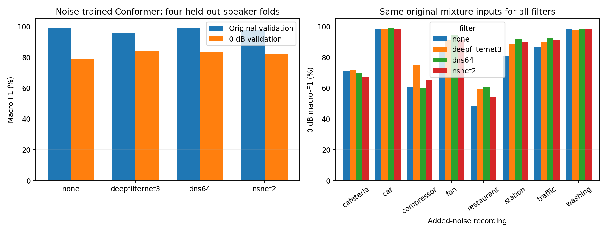

# 소음 혼합 Conformer: 잡음 제거기 3개 비교

사용자 요청에 따라 소음 혼합으로 학습한 Conformer의 기존 4-fold 최고 checkpoint만 고정하고, 추가 학습 없이 세 공개 잡음 제거기를 앞단에 적용했다. 무증강 학습본이나 속도·마스킹 결합 학습본은 비교하지 않았다.

## 결과

| 입력 필터 | 원본 F1 | 0dB F1 | 0dB 변화 | 잡음 단독 오반응률 |
| --- | ---: | ---: | ---: | ---: |
| 필터 없음 | 99.20% | 78.47% | +0.00%p | 4.22% |
| DeepFilterNet3 | 95.68% | 83.80% | +5.32%p | 12.81% |
| Meta DNS64 | 98.75% | 83.26% | +4.79%p | 38.12% |
| Microsoft NSNet2 | 97.61% | 81.86% | +3.39%p | 7.81% |

이번 개발 검증에서 0dB 평균 F1이 가장 높은 조건은 **DeepFilterNet3**다. 필터 없음 대비 +5.32%p이며, 원본 F1 변화는 -3.53%p다. 듣기에 잡음이 줄어드는 정도와 명령어 분류 성능을 구분해서 판단한다.

이번 앞단 적용은 **0dB 개선과 원본 손상·잡음 오반응 사이의 교환**이 있다. 잡음 단독 오반응률까지 함께 보고 실제로 적용할 조건을 판단해야 한다. 현재 결과만으로 필터를 기본 경로에 자동 채택하지 않았다.

점수는 4개 개발 화자의 held-out-speaker CV다. 0dB는 fold4×잡음8×추출3=96개 조건의 11-class macro-F1을 같은 가중치로 평균했다. 원본은 fold4 평균이다. 원본812개, 0dB 혼합19,488개, 잡음 단독640개, 총20,940개에 필터 없음/3개 필터를 각각 평가했다. 서로 다른 발화19,488개를 수집한 것이 아니라 원본812개를 소음·추출 조건별로 반복한 것이다.

기존 혼합20,128개는 원래 평가의 SHA256과 모두 일치한다. 필터 없는20,940개 분류 결과도 이전 소음 혼합 학습본의 예측과 전부 일치했다. -5/-10/+10dB는 이번 추가 실험 범위에 포함하지 않았다.

## 잡음별 0dB F1

| 잡음 | 필터 없음 | DeepFilterNet3 | DNS64 | NSNet2 |
| --- | ---: | ---: | ---: | ---: |
| cafeteria | 71.12% | 71.32% | 69.77% | 67.14% |
| car | 98.43% | 97.95% | 98.98% | 98.40% |
| compressor | 60.59% | 75.09% | 60.27% | 65.24% |
| fan | 84.80% | 90.78% | 94.01% | 91.06% |
| restaurant | 48.11% | 59.21% | 60.61% | 54.17% |
| station | 80.35% | 88.42% | 91.83% | 89.63% |
| traffic | 86.43% | 90.07% | 92.37% | 91.12% |
| washing | 97.96% | 97.53% | 98.24% | 98.14% |

## 적용 방식

- 세 필터 모두 혼합 파형만 입력받는다. 깨끗한 원본, 분리된 잡음, 정답, 소음 종류, SNR은 필터 입력에 없다.
- DeepFilterNet3: 공식48kHz 모델.16k→48k→16k, 공식 sinc_fast/float32 리샘플링과 STFT 지연480샘플 보정. postfilter와 감쇠 제한 없음.
- Meta DNS64: 공식16kHz Demucs(hidden64), dry=0. 모델 내부의 혼합 신호 기반 정규화와 복원을 그대로 사용한다.
- Microsoft NSNet2: 공식16k ONNX, FFT320/홉160/sqrt-Hann, 최소 이득−80dB. 공식 복원 후 오른쪽 flush160샘플만 제외한다.
- 모든 결과는16kHz·1.5초·float32. 외부 피크 정규화/클리핑/원본과의 혼합/원본에 맞춘 지연 탐색을 하지 않는다. 파일 간 모델/특징 상태를 초기화한다.
- 분류기4개는 기존 clean-best epoch를 그대로 쓴다. 필터별 epoch/분류 임계값/혼합 비율을 고르거나 모델을 재학습하지 않았다.
- 0dB는 원래1.5초 전체 파형 파워 대 추가 잡음 파워다. 원본에 이미 배경음/패딩이 있어 무잡음 활성 발화 기준0dB와 다르다. silence/잡음 단독은 각 fold 훈련 명령어600개의 RMS 중앙값 기준이다.

## 추가 처리 시간

RTX3090, 서버CPU2스레드, batch1, 1.5초 입력. 워밍업20회 후100회. 원본 CPU 파형부터 CPU 출력까지의 중앙값이다.

| 필터 | 필터만 | 필터+분류 전체 | 전체 p95 |
| --- | ---: | ---: | ---: |
| 필터 없음 | 0.04ms | 15.49ms | 15.69ms |
| DeepFilterNet3 | 15.00ms | 30.59ms | 32.24ms |
| Meta DNS64 | 7.07ms | 22.12ms | 22.90ms |
| Microsoft NSNet2 | 17.39ms | 33.90ms | 34.61ms |

DFN3/DNS64의 신경망과 분류기는GPU, NSNet2는ONNX CPU를 사용했다. 왕복 리샘플·상태 초기화·전송·분류기Fbank를 포함한다. 모델 로딩·WAV 디코딩·1.5초 창 확보·통신은 제외하며 스트리밍 알고리즘 지연 측정은 아니다. [측정 설정](latency_protocol.json)

## 근거와 한계

- 개발 화자4명·훈련seed1개이며 같은 개발 CV에서 필터를 고르는 결과다. 새 화자/녹음환경/최종 test 일반화를 확정하지 않는다. 이번 실행은 test spk01 오디오를 읽거나 추론하지 않았다. 프로젝트 과거 브랜치의 test 사용 이력과 별개다.
- 평가 잡음8개는 우리 분류기 훈련 잡음6개와 원본 단위로 분리했다. 외부 잡음 제거기의 DNS 사전학습 전체 원본과 평가 잡음의 중복은 완전히 감사하지 못했으므로, 잡음 제거기에도 미관측 잡음이라고 주장하지 않는다.
- 이미 소음으로 학습한 KWS는 범용 음질 개선기를 거쳐도 정확도가 자동으로 높아지지 않는다. 발화 특징 손실과 분류기 입력 분포 변화도 같이 측정해야 한다. [관련 KWS 연구](https://arxiv.org/abs/2309.16060)
- 공식 출처: [DeepFilterNet](https://github.com/Rikorose/DeepFilterNet), [Meta denoiser](https://github.com/facebookresearch/denoiser), [Microsoft NSNet2](https://github.com/microsoft/DNS-Challenge/tree/a052ad5a7714bcc6069b515666e837bf973099de/NSNet2-baseline). 정확한 revision/가중치/코드 SHA는 [고정 프로토콜](protocol.json)에 있다.

검증: [독립 재검사](independent_audit.json), [필터별 요약](summary.csv), [화자별 결과](speaker_summary.csv), [동일 파일에서 고쳐진/망가진 개수](paired_changes.csv), [듣기 샘플](../../runs/denoise-eval-v1/listening/README.md).
