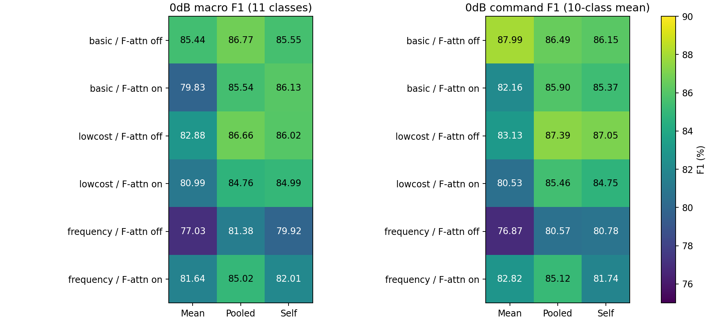

# 전체18조건 분석

결론: 이번 화자03/seed42 개발검증에서는 기존 local CNN+Pooled를 전체11종macro F1 기준으로 유지한다. 명령어만의 구별·잡음단독 오반응·원본 성능을 함께 보면 단일 순위로 모든 사용조건의 우열을 정할 수 없다.

[13개 로컬 완료 모델·학습기록 릴리스](https://github.com/CAS2250-audio-task/CAS2250-audio-repo/releases/tag/frequency-local-spk03-1000-v1-results). 133,889,862bytes,6,439파일. 원격digest와 로컬SHA256이 일치한다. 나머지 기존3개 및 다른서버Self2개는 릴리스 설명의 기존 패키지 링크를 따른다.

## 1. 세로 어텐션은 CNN에 따라 효과가 달랐다

| CNN | Mean 변화 | Pooled 변화 | Self 변화 |
|---|---:|---:|---:|
| basic | -5.61%p | -1.23%p | +0.57%p |
| lowcost | -1.89%p | -1.90%p | -1.03%p |
| frequency | +4.61%p | +3.64%p | +2.09%p |

세로 CNN의 Pooled는 단독 81.38%에서 세로 어텐션 추가 후 85.02%로 3.64%p 개선됐다. 하지만 기존 local Pooled의 86.77%보다 1.75%p 낮다. Self도 79.92→82.01%로 개선됐지만 기존 local Self 85.55%에 못 미쳤다. CNN 단독 결과만으로 결합 효과를 판단할 수는 없었으나, 조합을 확인해도 기존 기준을 대체할 근거는 얻지 못했다.

세로어텐션은basic Mean/Pooled와lowcost 세head에서 점수가 하락했다. 주파수관계를 전역으로 연결하는 것이 이번 데이터에서 항상 유리하지 않다는 결과다. 어느 주파수/음절에 잘못 집중했는지는 아직 확인하지 않았으며 attention map만으로 인과효과를 단정하지 않는다.

## 2. F1 상승과 명령어 구별 개선은 달랐다

| 조건 | 원본 F1 | 0dB 전체F1 | 0dB 정답률 | 명령어10종F1 | 잡음단독 오반응 |
|---|---:|---:|---:|---:|---:|
| basic/off/mean | 91.97% | 85.44% | 87.46% | 87.99% | 4.58% |
| basic/off/pooled_query | 95.42% | 86.77% | 86.64% | 86.49% | 11.88% |
| basic/off/self_cls | 96.30% | 85.55% | 86.15% | 86.15% | 12.08% |
| basic/F-attn/self_cls | 95.03% | 86.13% | 85.55% | 85.37% | 7.29% |
| lowcost/off/pooled_query | 93.66% | 86.66% | 87.48% | 87.39% | 23.54% |
| lowcost/off/self_cls | 94.93% | 86.02% | 86.86% | 87.05% | 13.33% |
| frequency/F-attn/pooled_query | 92.11% | 85.02% | 85.30% | 85.12% | 10.21% |

basic Self에 세로 어텐션을 추가하면 전체 macro F1은 85.55→86.13%지만 명령어 10종 F1은 86.15→85.37%, 정답률은 86.15→85.55%로 내려갔다. silence F1은 79.60→93.76%로 올라갔다. 같은 4872조건에서 기존 오답 330건을 고쳤지만 새 오답 359건이 생겼다. 따라서 명령어의 음절 구별이 개선됐다는 증거로 보지 않는다.

명령어10종F1은같은11클래스혼동행렬의명령어항목10개만평균한값이다. 명령어→silence오답을제거한재평가가아니다. 잡음단독오반응은별도480crop에서silence이외로예측한비율이다. 검증silence와서로다른조건이므로두지표를동일시하지않는다.

## 3. 소형2D는 근접 후보지만 무조건 이득은 아니다

lowcost Pooled의 86.66%는 기존 Pooled 86.77%와 0.11%p 차이다. noisy 정답률은 86.64→87.48%, 명령어 10종 F1은 86.49→87.39%로 개선됐다. 같은 입력에서 344건 회복, 303건 새 오답으로 순 41건 개선이었다. 하지만 원본 F1은 95.42→93.66%, 잡음 단독 오반응은 11.88→23.54%로 악화됐다.

lowcost Self도전체F1+0.47%p,명령어F1+0.90%p였지만원본F1은96.30→94.93%였다. 소형2D는실험가치가없던옵션은아니며,현재결과만으로일괄탈락보다는검출기후의명령어구별비교후보로남긴다. 다만한화자·한seed에서작은차이이므로일반적개선으로채택하지않는다.

## 4. 세로CNN 부진의 가능한 원인과 한계

세로CNN은원본에서도점수가낮아,추가잡음에만취약해진문제로설명할수없다. basic은mel위치를입력채널로구분하지만,frequency CNN은대역을따라공유필터를적용하고마지막에주파수평균을한다. 이설계가절대적인대역위치정보를약하게만들었을가능성은있다. 그러나패딩경계등의위치단서도남고,중간경로의채널수·정규화통계·CNN구성도함께달라져이원인을확정할수없다.

주파수축보존이라는가설전체의실패가아니라이번특정F/T CNN의결과다. 여성화자일반화도이실험으로판단하지않는다. 검증은화자03하나였으며화자02결과가없다.

## 5. 남은 오류: 식당과 구별이 어려운 명령어

기존local Pooled의소음별오분류율은restaurant27.59%,compressor20.36%,cafeteria19.05%다. 세로CNN+세로어텐션Pooled는restaurant23.32%,compressor19.21%로일부개선했지만다른조건에서손해가나전체기준을넘지못했다.

기존Pooled의주요혼동은재시작→시작102건,전진→정지51건,복귀→대기39건,정지→전진38건이다. 각명령어는20녹음×8소음×3draw=480조건이며독립480녹음이아니다. basic Self+세로어텐션은재시작→시작149건이었다. 따라서세로어텐션이첫음절구별을해결했다고주장할수없다.

## 6. 1000epoch보다 더 학습할 근거는 약하다

18개 모두 1000epoch 종료점 F1이 선택 checkpoint보다 낮았고 차이의 중앙값은 약 -4.00%p다. 검증에 맞춘 최고점 선택의 효과가 포함되므로 과적합만의 증명은 아니다. 그러나 이 결과를 보고 무조건 학습 기간을 늘리는 것은 지지되지 않는다. 선택 best와 종료 last를 별도로 보존한다.

## 다음 판단

기준은local Pooled를유지하되,검출기로발화구간을제한한비교에서는Mean을포함해음성구별과silence거부를분리한다. 검출기가잡음거부를담당할때소형2D의명령어성능이남는지는후속검증사항이다. 현재그실험을새로실행하지않았다.

모든결과는동일화자03/seed42개발검증에서checkpoint를고르고평가한결과다. 선택draw0가최종3draw에포함된다. 같은원본을공유한소음합성조건이므로4872행을독립표본으로보는유의성검정은하지않는다.

[전체비교](all18_comparison.csv) · [세로어텐션효과](vertical_effects.csv) · [명령어별오류](class_errors.csv) · [소음별오류](noise_errors.csv) · [혼동](confusions.csv) · [회복과새오답](paired_changes.csv) · [선택점과종료점](last_vs_selected.csv)
