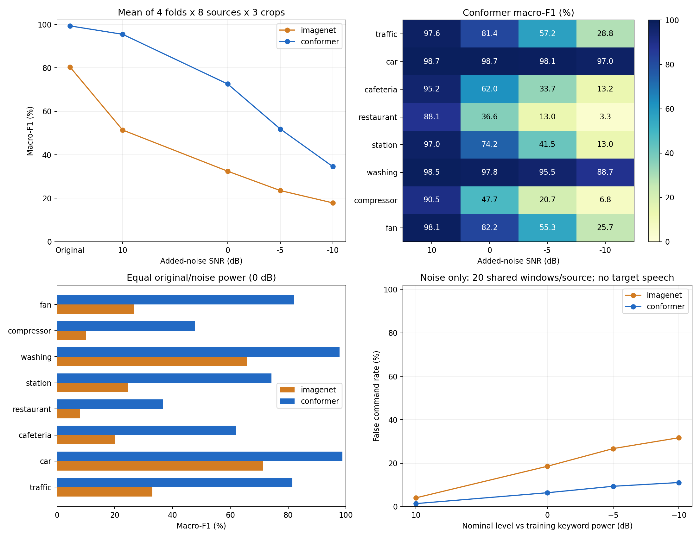

# 실제 환경 소음 스트레스 평가

개발 화자 4-fold의 ResNet18과 미세조정 Conformer를 고정하고 실제 환경 소음 8종을 추가했다. 새 학습이나 설정 탐색 없이 각 모델의 기존 최고 checkpoint를 사용했다.

| 조건 | ResNet macro-F1 | Conformer macro-F1 |
| --- | ---: | ---: |
| 원본 | 80.38% | 99.32% |
| 10dB | 51.40% | 95.46% |
| 0dB | 32.44% | 72.57% |
| -5dB | 23.54% | 51.88% |
| -10dB | 17.85% | 34.56% |

원본은 4개 fold 평균, 추가 소음은 4개 fold × 8개 원본 × 3회 구간의 macro-F1 평균이다. 소음 원본마다 같은 가중치를 준다(도로 2·군중 3·기계 3). 명령어 10개와 silence의 11클래스 macro-F1이며, 전체 예측을 합쳐 계산한 F1과는 다르다.

Conformer가 모든 평균 조건에서 ResNet보다 높았지만, 강한 소음에서는 성능이 크게 떨어졌다. 특히 식당과 공기압축기 녹음에 취약했다. 같은 −10dB라도 차량 내부 96.97%, 식당 3.31%로 차이가 커서 SNR만으로 난도를 설명하기 어렵다.



## 소음별 Conformer macro-F1

| 환경 | 원본 길이 | 10dB | 0dB | −5dB | −10dB |
| --- | ---: | ---: | ---: | ---: | ---: |
| 도로 교차로 | 5.0분 | 97.65% | 81.44% | 57.18% | 28.83% |
| 차량 내부 | 5.0분 | 98.74% | 98.72% | 98.10% | 96.97% |
| 구내식당 | 5.0분 | 95.22% | 61.97% | 33.75% | 13.25% |
| 식당 | 5.0분 | 88.08% | 36.59% | 12.97% | 3.31% |
| 역 | 5.0분 | 96.95% | 74.20% | 41.50% | 12.96% |
| 세탁기 | 5.0분 | 98.51% | 97.79% | 95.52% | 88.67% |
| 공기압축기 | 60.0분 | 90.48% | 47.69% | 20.73% | 6.82% |
| 환풍기 | 30.0분 | 98.06% | 82.16% | 55.25% | 25.66% |

## 음성 없이 소음만 넣었을 때

정답을 silence로 두고 명령어로 반응한 비율을 측정했다. 소음마다 20개 구간을 뽑아 4개 fold 모델에 동일하게 넣었다. 각 fold의 훈련 키워드 600개 RMS 중앙값을 기준으로 잡음 수준을 맞췄다.

| 명목 수준 | ResNet 오반응률 | Conformer 오반응률 |
| --- | ---: | ---: |
| 10dB | 4.06% | 1.41% |
| 0dB | 18.59% | 6.41% |
| -5dB | 26.72% | 9.38% |
| -10dB | 31.72% | 11.09% |

## 평가와 해석

- 긴 녹음에서 연속 1.5초를 파일별 3회 무작위 추출했다. 모든 모델과 SNR에 같은 구간을 사용했다. 경로·소음 ID·반복 번호로 추출 시드를 정한다.
- SNR은 원본 전체 1.5초의 파워와 추가 잡음 파워의 비다. 기존 배경음·패딩을 포함하므로 깨끗한 발화만의 SNR은 아니다. 0dB는 두 파워가 같고, −10dB는 추가 잡음 파워가 10배다. silence는 훈련 키워드 RMS 중앙값을 기준으로 한 명목 SNR이다.
- 잡음의 DC만 제거하고 거의 무음인 구간은 재추출했다. 클리핑을 막을 때 혼합 전체에 같은 선형 감쇠를 적용해 SNR을 유지했다. 이에 따른 절대 음량 변화도 현재 시스템 평가에 포함된다.
- 군중 녹음에는 배경 사람 음성이 포함된다. 목표 발화는 기존 파일의 명령어이며 배경 발화를 별도 명령으로 주석하지 않았다. 배경 언어도 통제하지 않았다.
- 원본 8개에서 구간을 반복한 결과다. 수만 개 혼합이 수만 개 독립 환경을 뜻하지 않는다. fold의 학습 화자도 겹친다. 학습 시드 42 하나의 개발 평가다.
- 혼합 평가로 거리·잔향·마이크 왜곡·실제 환경의 비선형 녹음까지 재현하지는 못한다. unknown 단어도 평가하지 않았다.
- 이번에는 test spk01을 불러오거나 추론하지 않았다. Conformer의 최종 test 결과는 아직 없다. 프로젝트 전체에서는 이전 jaehun의 선택된 모델이 test를 평가한 이력이 있다.
- 이 소음 원본 8개 전체를 개발 평가용으로 예약했다. 향후 증강 학습과 최종 test용 소음에는 다른 원본을 사용한다. 같은 녹음의 다른 구간이나 마이크는 독립 원본으로 취급하지 않는다.

실제 명령어가 있는 −10dB 입력에서 Conformer는 33.69%를 맞히고, 46.92%를 silence로 놓쳤으며, 19.39%를 다른 명령어로 혼동했다. [명령어 오류 유형](keyword_error_modes.csv)에 소음별 비율을 저장했다.

## 직접 듣기

미리 정한 spk02의 ‘출발’ 1개에 첫 번째 추출 구간을 혼합한 예시다. 결과를 보고 예시를 고르지 않았다. 현재 서버의 캐시 파일 링크이며, 듣기 파일에 혼합 후 별도 음량 정규화를 적용하지 않았다.

[원본](../../runs/noise-stress-v1/examples/original.wav)

| 소음 | 10dB | 0dB | −10dB |
| --- | --- | --- | --- |
| 도로 교차로 | [듣기](../../runs/noise-stress-v1/examples/traffic_10dB.wav) | [듣기](../../runs/noise-stress-v1/examples/traffic_0dB.wav) | [듣기](../../runs/noise-stress-v1/examples/traffic_-10dB.wav) |
| 구내식당 | [듣기](../../runs/noise-stress-v1/examples/cafeteria_10dB.wav) | [듣기](../../runs/noise-stress-v1/examples/cafeteria_0dB.wav) | [듣기](../../runs/noise-stress-v1/examples/cafeteria_-10dB.wav) |
| 공기압축기 | [듣기](../../runs/noise-stress-v1/examples/compressor_10dB.wav) | [듣기](../../runs/noise-stress-v1/examples/compressor_0dB.wav) | [듣기](../../runs/noise-stress-v1/examples/compressor_-10dB.wav) |
| 환풍기 | [듣기](../../runs/noise-stress-v1/examples/fan_10dB.wav) | [듣기](../../runs/noise-stress-v1/examples/fan_0dB.wav) | [듣기](../../runs/noise-stress-v1/examples/fan_-10dB.wav) |

## 출처와 재현

[DEMAND](https://zenodo.org/records/1227121): Joachim Thiemann, Nobutaka Ito, Emmanuel Vincent. 16kHz 원본의 ch01만 사용했다. 설명은 CC BY-SA 3.0, 현재 API 필드는 CC BY 4.0으로 달라 둘 다 기록했다.

[RPi 환경 녹음](https://zenodo.org/records/7493820): Gaurav Govilkar, Kader BT Shaikh, N Gopalkrishnan. API에 CC BY 4.0이 명시돼 있다. 공기압축기 60분·환풍기 30분 원본을 mono 16k로 변환했다. 원본을 보존하고 평가용 사본을 만들었다. 두 자료 모두 원배포 MD5와 준비 파일 SHA256을 확인했다.

[고정 프로토콜](protocol.json) · [소음 출처·해시](noise_sources.json) · [SNR별 결과](snr_summary.csv) · [소음별 결과](noise_summary.csv) · [화자별 결과](speaker_summary.csv) · [조건별 지표](condition_metrics.csv) · [전체 파일 예측](predictions.csv.gz) · [추출위치·혼합해시](mixtures.csv.gz)

```bash
OMP_NUM_THREADS=2 MKL_NUM_THREADS=2 OPENBLAS_NUM_THREADS=1 runs/conformer-env/bin/python -m experiments.noise_stress.sources
OMP_NUM_THREADS=2 MKL_NUM_THREADS=2 OPENBLAS_NUM_THREADS=1 runs/conformer-env/bin/python -m experiments.noise_stress.run
runs/conformer-env/bin/python -m experiments.report_noise_stress
OMP_NUM_THREADS=2 MKL_NUM_THREADS=2 OPENBLAS_NUM_THREADS=1 runs/conformer-env/bin/python -m experiments.check_noise_stress
```

모델·평가 캐시·듣기 예시는 `runs/noise-stress-v1/`, 실행 로그는 `execution.log`에 있다. 완료 조건은 재개 시 건너뛰며 동결 프로토콜이 달라지면 거부한다.

[집계 검사](aggregation_audit.json) · [독립 재추론 검사](independent_replay.json) · [검증 기록](VALIDATION.md)
