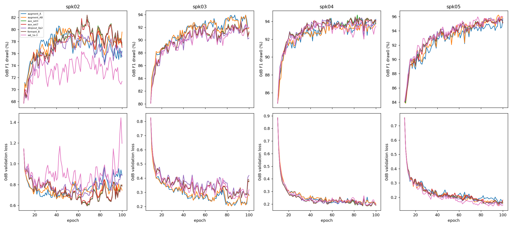

# Overnight: 정규화 → 포먼트 증강 → 보조음향 → DFN3

상태: `complete`, 조건 `formant_B`, 화자 ``, epoch ``.

별도 브랜치 overnight-regularization-formant-aux. 원본 test01은 사용하지 않는다.
공통 epoch10 LAST에서 모델·AdamW·RNG를 복원하고100까지 학습한다. 초기10epoch는 이전실험 공통 상태이며 새 후보 변화는epoch11부터 적용한다.
4fold·seed42·batch16·609draw/epoch. 인코더1e-5/head5e-4 유지, 전체 인코더 학습, 조기 종료 없음.
WD1e-3과encoder dropout0.2를 각각 비교, 둘 다 유효하면 결합. 선택 조건에서 A=SpecAugment+속도+피치, B=포먼트 한 설정, A+B를 비교한다. 기존소음혼합은공통으로유지한다.
피치는파일내±1반음 anchor변화, 속도0.9~1.1배와발화보호, 포먼트비율1/1.1~1.1. 각정책p0.5독립이며7가지파형조합별고정2변형을준비한다. 실제혼합파형에서보조를추출하고시간마스킹은보조값·availability에도적용한다.
보조는세트0·3·7로비교한다. 원본train 유효프레임으로만 scaler를 적합한다. aux CNN을 시간 정렬해인코더 출력에잔차로더하며256→11head유지, 초기aux projection은0이다.
조건 선택은 전체3draw0dB 개발4fold F1이 기준보다0.5%p 이상 높고 최저화자F1하락1%p이내일때. 미세한변화는 통계적우월성으로주장하지않는다.
마지막에는 선택된동일모델에DFN3off/on. 필터후파형에서보조도다시추출한다. 기존 공식B16필터캐시를재사용한다.
저장: 각후보best와전체epoch기록보존. 완료분기의큰LAST optimizer는검증후삭제하고미완료분기만재개상태유지. 기존실험파일은수정하지않는다.

[실시간 상태](progress.json) · [로그](../../runs/overnight-v1/execution.log) · [프로토콜](protocol.json)

| 후보 | 완료fold | 0dB F1 | 0dB 정확도 | 최저화자 F1 |
|---|---:|---:|---:|---:|
| augment_A | 4/4 | 90.68% | 91.10% | 80.15% |
| augment_AB | 4/4 | 90.85% | 91.40% | 80.21% |
| aux_set3 | 4/4 | 91.30% | 91.91% | 81.94% |
| aux_set7 | 4/4 | 90.91% | 91.45% | 81.28% |
| baseline | 4/4 | 89.75% | 90.19% | 76.63% |
| dropout_0p2 | 4/4 | 90.67% | 91.31% | 79.35% |
| formant_B | 4/4 | 91.30% | 91.87% | 81.95% |
| wd_1e-3 | 4/4 | 89.64% | 90.11% | 76.79% |

선택 regularization: `dropout_0p2`

선택 augmentation: `formant_B`

선택 auxiliary: `formant_B`

[완료 검증](independent_audit.json)

완료 결과 해석: [RESULTS.md](RESULTS.md).
