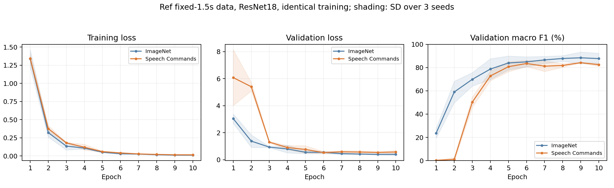

# ref 기준: 스펙트로그램 음성 사전학습 비교

브랜치 `pretrain`은 `origin/reference/ai-baseline`의 `6d208bc`에서 시작했다. `jaehun`의 새 데이터·보조 특징·CV 설정을 가져오지 않았다. ref의 fixed-1p5-v1 데이터, train609(spk02/03/04) / validation203(spk05), 16kHz·1.5초·128-bin log-mel·ResNet18·512→11 분류층·10epoch·무증강·LR5e-4·WD1e-4를 유지했다.

## 사용한 음성 사전학습

[CLAR 공식 코드](https://github.com/haideraltahan/CLAR)의 공개 `sp_2d_100_fd_tm/sc09/epoch=1000.ckpt`다. Speech Commands SC09의 짧은 영어 숫자 발화를 분류한 supervised 2D ResNet18이다. 메타데이터의 저장 epoch는1002다. 한국어 ASR나 원시 파형 Transformer를 사용한 실험은 아니다.

원래 입력은 STFT magnitude(dB)·STFT phase·log-mel의3채널이다. ref 입력을 유지하기 위해 첫 conv에서 log-mel인 채널2의 가중치를 선택했고, 본체의120개 가중치/BN 통계 텐서를 모두 옮겼다. 원래 분류층은 제외하고 ref의512→11층을 새로 학습했다. 같은 시드의 두 모델은 새 분류층 초기값이 동일하다.

## 결과: ref와 같은 실행별 최고 checkpoint 기준

| 초기화 | 3시드 평균 검증 F1 | 평균 정확도 | 학습 원본 F1 | 학습–검증 F1 격차 |
| --- | ---: | ---: | ---: | ---: |
| imagenet | 89.26% | 88.34% | 100.00% | 10.74%p |
| speech_sc09 | 85.21% | 84.73% | 99.60% | 14.39%p |

이 전이 방식의 음성 사전학습은 ImageNet 대비 평균 F1 **-4.05%p**였다. 현재 ref 설정에서 개선을 확인하지 못했으므로 기존 ImageNet 기준을 유지한다.

| 시드 | ImageNet 최고 epoch / F1 | 음성 최고 epoch / F1 | 차이 |
| --- | ---: | ---: | ---: |
| [42](seed42_files.md) | 9 / 92.38% | 6 / 84.90% | -7.47%p |
| [43](seed43_files.md) | 9 / 90.15% | 5 / 85.21% | -4.94%p |
| [44](seed44_files.md) | 8 / 85.25% | 7 / 85.52% | +0.28%p |

## 전체 평균으로 공통 epoch 하나를 골랐을 때

| 초기화 | 공통 epoch | 3시드 평균 검증 F1 |
| --- | ---: | ---: |
| imagenet | 9 | 88.43% |
| speech_sc09 | 9 | 84.25% |

각 시드 링크에 두 모델의 다른 예측·음성 파일 링크를 넣었다. 원래 ref의 단일seed42 기록 F1 92.58%와 이번 재학습92.38%는 완전히 같은 재현값은 아니다. 이번 비교에는 같은 환경에서 새로 측정한 ImageNet 대조군을 사용했다.

## 해석 범위

- 짧은 단어 음성·스펙트로그램·ResNet18이라는 조건은 가깝지만 영어 숫자와 한국어 명령어, 원래3채널 스펙트로그램과 ref의1채널 log-mel은 차이가 있다. 사전학습 도메인·입력 채널 적응·BN 통계 차이가 결과에 영향을 줬을 수 있으며 원인을 분리한 실험은 아니다.
- 음성 사전학습 전체가 ImageNet보다 나쁘다는 결론은 아니다. 선택한 공개 가중치를 ref 입력으로 옮긴 이번10epoch 설정의 결과다.
- test spk01은 추론하지 않았다. 조건·epoch 선택에 쓰인 단일 검증 화자203개의 개발 결과이며 3시드는 같은 파일을 반복한다.

## 검증과 재현

- 총6회·60epoch. 원래 ref의 `src/`와 기본 설정을 변경하지 않고 별도 runner에서 초기화만 바꿨다.
- 실제 checkpoint·코드·데이터1,015개 해시, 동일 분류층 초기값, 전체 본체120개 텐서, 모델 파라미터 수11,175,883개를 확인했다. 60개epoch의12,180개 검증 예측에서 정확도/F1을 재계산했다.
- 기존 ref 테스트와 전이 검증 테스트 합계32개 통과. 기존 jaehun 브랜치 커밋 전55개 테스트도 통과했다.
- [사전 프로토콜](protocol.json), [공개 모델 출처](pretraining_source.json), [실행별 요약](run_summary.csv), [전체 학습 기록](all_epoch_history.csv), [짝 비교](paired_summary.csv).

```bash
cd /root/audio/.worktrees/pretrain
OMP_NUM_THREADS=2 MKL_NUM_THREADS=2 OPENBLAS_NUM_THREADS=1 /root/audio/.venv/bin/python -m experiments.pretrain.run
/root/audio/.venv/bin/python -m experiments.report_speech_pretrain
```


